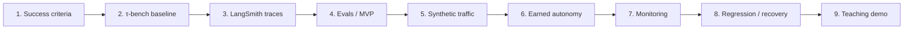

# Development Plan — Agent Autonomy Lab

**Status:** Plan and specification; the lab Python project, its dependency-rule checks, the trace event schema, and the LangSmith trace adapter exist; the Milestone 2 baseline has been exported to LangSmith, one task has been run live through a traced lab agent, an injected tool failure has been inspected in its trace, and a thread-level evaluator has judged a traced conversation. Milestones 0 (repository and workflow setup), 1 (project and success criteria), and 2 (install and run τ-bench) are complete; Milestone 3 (integrate LangSmith observability) is in progress.

**This file is the canonical implementation plan.** Supporting specifications live in [`docs/`](docs/). When scope, order, or acceptance criteria change, update this file and record the decision in [docs/DECISIONS.md](docs/DECISIONS.md).

| Field | Value |
| --- | --- |
| Baseline date | October 18, 2026 |
| Plan version | 1.0 |
| Implementation status | **Started:** project skeleton (Milestone 3) |
| Repository strategy | Single `agent-autonomy-lab` repository; separate upstream τ-bench checkout |
| Initial domain | Retail, text-based, multi-turn customer support |
| Primary observability platform | LangSmith |
| Execution rhythm | Design → implement → verify → review → proceed |
| Goal | Demonstrate monitoring, observability, evaluation, and evidence-based earned autonomy |

## 1. Why we are building this

This is not another RAG answer-quality benchmark. It demonstrates **operating a tool-using AI product**: measuring real (simulated) transaction outcomes, identifying policy violations, diagnosing failures in traces, and determining how much independent authority the agent should have. The teaching case study is an AI Support Agent Bot whose authority develops like an employee's: it begins under supervision and earns bounded trust through performance.

The governing rule is: **increase autonomy based on verified performance, never on persuasive answers alone; authorization is enforced in software and approved by accountable humans.**

Read [PROJECT_BRIEF](docs/PROJECT_BRIEF.md) for audience, outcomes, and scope, [AUTONOMY](docs/AUTONOMY.md) for precise permission semantics, and [EVALUATION](docs/EVALUATION.md) for measurement details.

**Development process:** Milestone 0 set up the repository, issue templates, labels, branch protection, and pull request review. Every milestone follows the issue → branch → pull request → review workflow in [CONTRIBUTING.md](CONTRIBUTING.md).

## 2. How the milestones fit together



**Minimum viable teaching checkpoint:** end of Milestone 4.  
**Distinctive governance demo:** end of Milestone 6.  
**Full operating lifecycle demo:** end of Milestone 9.

| # | Milestone | Primary deliverable | Status |
| --- | --- | --- | --- |
| 0 | Repository and workflow setup | Repository, issue templates, labels, protected `main`, [CONTRIBUTING.md](CONTRIBUTING.md) | Complete |
| 1 | Establish project and success criteria | Approved scope, metrics, three scenario specifications, initial evidence contract | Complete |
| 2 | Install and run τ-bench | Five inspectable baseline simulations, reproducibility manifest | Complete |
| 3 | Integrate LangSmith observability | Correlated conversation, LLM, tool, and decision traces | In progress |
| 4 | Build the evaluation framework | Tested evaluators and ~20-case baseline scorecard | Not started |
| 5 | Generate simulated production traffic | 50–100 labeled, reproducible multi-turn sessions and traffic analysis | Not started |
| 6 | Implement earned autonomy | Four-level authorization gate, approval flow, policy tests, review history | Not started |
| 7 | Build operational monitoring | Operational/quality dashboards, signal definitions, and alert tests | Not started |
| 8 | Introduce and diagnose regressions | Controlled regression, failed trace, regression test, documented recovery | Not started |
| 9 | Prepare the teaching demonstration | Repeatable runbook, presentation artifacts, rehearsed live/backup flow | Not started |

### Working definition of a milestone

Each milestone has **inputs/prerequisites**, **steps**, **deliverables**, **verification evidence**, and **acceptance criteria**. We do not mark a milestone complete merely because code exists: its result must be reproducible and inspectable. Tests, measurements, and screenshots/trace IDs are recorded when produced, not invented in advance.

Every milestone's Acceptance Criteria also include: **each open question in [docs/DECISIONS.md](docs/DECISIONS.md) that targets this milestone is resolved (decision recorded) or re-targeted with a stated reason.**

### Suggested artifact layout as implementation grows

```text
agent-autonomy-lab/
├── README.md
├── DEVELOPMENT.md                # authoritative milestone tracker
├── docs/                         # project, architecture and teaching specifications
├── pyproject.toml                # project, dependencies, import-linter contracts
├── .env.example                  # placeholders only, never real keys
├── src/agent_autonomy_lab/       # ports-and-adapters (ADR-013); layer packages exist
│   ├── domain/                   # pure logic: no τ-bench, LangSmith, or provider SDK imports
│   │   ├── autonomy/             # levels, permission matrix, gate decisions, review state
│   │   ├── evaluation/           # scoring rules and result records
│   │   └── events/               # gate event and identifier schema
│   ├── ports/                    # Protocols: ToolExecutor, AuthorizationGate, TraceSink,
│   │                             #   ApprovalSource, Evaluator, ModelClient
│   ├── application/              # use cases: run simulation, evaluate run, label traffic,
│   │                             #   review autonomy, derive monitoring metrics
│   ├── adapters/                 # the only code that imports third-party infrastructure
│   │   ├── tau2/                 # τ-bench agent/orchestrator hook, ToolExecutor, run metadata
│   │   ├── langsmith/            # TraceSink
│   │   ├── models/               # ModelClient (LiteLLM / provider SDK)
│   │   ├── approvals/            # ApprovalSource: fixture; FastAPI UI only if M6 chooses one
│   │   └── evaluators/           # LLM judge and τ-bench reward reader
│   └── entrypoints/              # composition root: CLI and scripts wire adapters to use cases
├── tests/                        # unit/integration/regression cases
├── datasets/                     # planned scenario definitions and safe examples
├── scripts/                      # planned repeatable run utilities
├── reports/                      # planned run manifests and evaluation summaries
└── demo/                         # planned teaching materials and backup evidence
```

Milestone 3 created `pyproject.toml`, `.env.example`, the five layer packages, and `tests/`, then the trace event schema (`domain/events/`), the `TraceSink` port (`ports/trace_sink.py`), and the composition-root settings (`entrypoints/`); the other subpackages and directories are **planned**. The layout follows [ADR-013](docs/DECISIONS.md#adr-013--adopt-the-ports-and-adapters-architecture): dependencies point inward, and only `adapters/` and `entrypoints/` import τ-bench, LangSmith, or a provider SDK (see [ARCHITECTURE.md](docs/ARCHITECTURE.md#code-structure-ports-and-adapters)). τ-bench remains a sibling clone or separately pinned dependency unless a later decision changes that.

---

## Milestone 1 — Establish project and success criteria

**Objective:** Define exactly what successful service, acceptable conduct, and trustworthy evaluation mean before building the system.

**Status:** Complete. The scope and rubric were accepted in [ADR-012](docs/DECISIONS.md#adr-012--accept-the-milestone-1-scope-and-rubric) (October 26, 2026).

**Prerequisites:** None. This is the first planning milestone.

### Steps

- [x] **1.1** Confirm audience (primarily product managers), the lesson sequence, and the central earned-autonomy claim.
- [x] **1.2** Confirm scope: τ-bench retail/text; local simulation; synthetic accounts; LangSmith; no production integrations or public-facing app.
- [x] **1.3** Specify **three candidate workflows**: order lookup/status, eligible pending-order cancellation, and eligible return/exchange. Document intended correct outcome, disallowed behavior, and risk tier for each. Verify their actual availability in Milestone 2; avoid invented τ-bench task IDs.
- [x] **1.4** Select initial metrics (the [scorecard](docs/EVALUATION.md#initial-scorecard--evidence-matrix)): task success, policy compliance, tool correctness, authentication compliance, confirmation compliance, escalation correctness, customer experience, operational efficiency, unauthorized attempts, and unauthorized executions. Record what source can prove each metric.
- [x] **1.5** Classify **hard failures** (e.g. unauthorized execution) separately from scored soft qualities (e.g. clarity). Distinguish attempted violations from executed violations.
- [x] **1.6** Define ground-truth boundaries: hidden task objectives/state for offline scoring only; traces for online-style evaluation.
- [x] **1.7** Draft per-workflow acceptance scenarios (happy path, ambiguous request, missing consent/identity, ineligible action) and define terminology and metadata fields.
- [x] **1.8** Record assumptions, questions to validate against upstream retail policies, and initial cost/privacy constraints.

### Deliverables

1. [`docs/PROJECT_BRIEF.md`](docs/PROJECT_BRIEF.md) — ratified goals, audience, scope, and learning outcomes.
2. [`docs/DECISIONS.md`](docs/DECISIONS.md) — decision log and the open questions (assumptions) that later milestones must confirm.
3. [`docs/EVALUATION.md`](docs/EVALUATION.md) — initial measurement rubric, known limitations, evidence plan, and the initial **scenario specifications** (candidate acceptance contracts for the three workflows: expected outcomes, policy checks, and classification); add machine-readable fixtures once schemas are known.
4. [`docs/AUTONOMY.md`](docs/AUTONOMY.md) — provisional levels and non-negotiable permission rules.
5. [`docs/ARCHITECTURE.md`](docs/ARCHITECTURE.md) — target architecture and telemetry contract.
6. [`docs/SIMULATION.md`](docs/SIMULATION.md) — synthetic customer simulation and traffic strategy.
7. [`docs/OPERATIONS.md`](docs/OPERATIONS.md) — monitoring, incident response, and recovery specification.
8. [`docs/DEMO.md`](docs/DEMO.md) — proposed teaching demonstration runbook.
9. `DEVELOPMENT.md` (this file) — the canonical plan.
10. [`README.md`](README.md) — project landing page.

### Acceptance Criteria

- [x] For each candidate workflow, we can explain a correct final state, how to verify it, and at least one unacceptable behavior.
- [x] We can distinguish **successful outcome**, **compliant behavior**, and **good customer experience** without treating them as a single score.
- [x] No metric depends on hidden ground truth in a production-style online judge.
- [x] The initial rubric and teaching scope have been reviewed and accepted.

**Dependencies / risks:** Retail capabilities, policies, and task IDs were verified in Milestone 2, and the scenario language was updated to match ([ADR-015](docs/DECISIONS.md#adr-015--map-real-retail-tasks-to-the-three-workflows), [#50](https://github.com/mwalker-tmd/PMA-agent-autonomy-lab/issues/50)); workflow 1 is adapted to an order detail lookup. **No application code is required for completion.**

---

## Milestone 2 — Install and run τ-bench

**Objective:** Establish an unmodified, reproducible baseline using the open-source benchmark, with inspectable customer conversations and tool trajectories.

**Status:** Complete (October 27, 2026). The unmodified five-task baseline and its inspection are in [docs/BASELINE.md](docs/BASELINE.md) and [`reports/m2-baseline/`](reports/m2-baseline/); the decisions are [ADR-013](docs/DECISIONS.md#adr-013--adopt-the-ports-and-adapters-architecture), [ADR-014](docs/DECISIONS.md#adr-014--use-gpt-6-luna-for-the-agent-and-the-simulated-user), and [ADR-015](docs/DECISIONS.md#adr-015--map-real-retail-tasks-to-the-three-workflows).

**Prerequisites:** Milestone 1 scope and preliminary metrics.

### Steps

- [x] **2.1** Confirm the `.gitignore` from Milestone 0 covers credentials and the result paths τ-bench actually writes; extend it if not. (The repository and documentation already exist from Milestones 0–1.)
- [x] **2.2** Install/verify `uv` and Python compatible with upstream (currently `>=3.12,<3.14`). Record local versions.
- [x] **2.3** Clone `https://github.com/sierra-research/tau2-bench` **alongside** this repo, not as an accidental nested Git repository; record upstream commit/tag.
- [x] **2.4** Run `uv sync`, configure a local `.env` (no credentials in Git), and validate the benchmark CLI/data.
- [x] **2.5** Read actual retail tools, policy, task descriptions, and [task evaluation documentation](https://github.com/sierra-research/tau2-bench/blob/main/docs/evaluation.md).
- [x] **2.6** Execute five baseline retail task attempts, one trial each, with pinned model names, seed, and concurrency; save original results.
- [x] **2.7** Inspect at least one complete multi-turn conversation: user turns, agent turns, tool-call arguments, tool results, final state, benchmark score.
- [x] **2.8** Identify actual task IDs suitable for the three workflows (adapt if necessary); identify API/extension paths for our LangSmith adapter.
- [x] **2.9** Record failure cases and costs, and separate benchmark findings from speculative improvements.

### First-run reference commands

From this repo's root (both repos will then be siblings):

```bash
git clone https://github.com/sierra-research/tau2-bench.git ../tau2-bench
cd ../tau2-bench
uv sync
cp .env.example .env
# Put the required API key in the LOCAL .env file (never commit it).
uv run tau2 check-data
uv run tau2 intro
uv run tau2 run \
  --domain retail \
  --agent-llm openai/responses/gpt-6-luna \
  --user-llm openai/responses/gpt-6-luna \
  --agent-llm-args '{"reasoning_effort": "medium"}' \
  --user-llm-args '{"reasoning_effort": "medium"}' \
  --num-trials 1 \
  --num-tasks 5 \
  --seed 42 \
  --max-concurrency 1
uv run tau2 view
```

These are the commands the Milestone 2 baseline actually ran ([#41](https://github.com/mwalker-tmd/PMA-agent-autonomy-lab/issues/41); manifest in [`reports/m2-baseline/manifest.yaml`](reports/m2-baseline/manifest.yaml)). The model is `gpt-6-luna` for both the agent and the simulated user. τ-bench's default `temperature: 0.0` is rejected by that model, and frontier models are replacing temperature with reasoning effort, so the commands pin `reasoning_effort` instead. The `openai/responses/` prefix routes calls through LiteLLM's Responses API bridge, which `gpt-6-luna` requires to combine tools with reasoning. Capture a precise version before comparing results.

### Deliverables

1. Five baseline retail simulation **attempts** with viewable outputs (document any blocked/failed attempts; rerun until a valid sample is available).
2. Run manifest: τ-bench commit/tag, Python/`uv` versions, models, task IDs, seed, trial count, runtime settings, date, and cost if available.
3. Baseline inspection note: scoring behavior, field names, supported tool actions, and limitations.
4. Real task-to-workflow mapping for the selected three cases.
5. Short extension-point recommendation for LangSmith tracing and subsequent gate instrumentation.

### Acceptance Criteria

- [x] Five completed retail task results are accessible or a precise environmental blocker is recorded.
- [x] At least one complete conversation can be reconstructed from persisted results.
- [x] We know what τ-bench counts as success and what it **does not** guarantee (including independent process/policy checks).
- [x] Actual task IDs and upstream version are recorded; no made-up scores or workflows.
- [x] Changes to upstream benchmark behavior are **zero** in this baseline.

**Dependencies / risks:** Model-provider credentials, API cost/rate limits, benchmark evolution, task-data availability, partial results. Maintain unchanged upstream results separately from our modified experiments.

---

## Milestone 3 — Integrate LangSmith observability

**Objective:** Make a multi-turn customer conversation reconstructable, with LLM calls, tool calls, failures, and version metadata correlated. Observability should let us understand the agent's behavior without changing it.

**Prerequisites:** Milestone 2 baseline and identified supported integration point.

### Steps

- [x] **3.1** Configure a separate LangSmith project and local credentials; confirm retention/privacy settings for synthetic data.
- [ ] **3.2** Build the smallest adapter around τ-bench's custom-agent/orchestration extension point rather than forking upstream immediately.
- [x] **3.3** Trace each customer session, agent turn, model call, tool call/result, exception, and available token/cost/latency data.
- [x] **3.4** Correlate with stable identifiers: simulation ID, thread/conversation ID, scenario/task ID, turn index, model/prompt/agent version, autonomy level.
- [x] **3.5** Ensure top-level LangSmith thread runs contain supported `messages` input/output structures. Where relevant, test visibility of child tool spans separately.
- [x] **3.6** Attach `traffic_type=synthetic`; redact secrets; ensure no hidden answer keys appear in agent-visible traces.
- [x] **3.7** Run one known customer task and one failing/exceptional case through the adapter. Compare traced behavior to the τ-bench saved result.
- [ ] **3.8** Document trace navigation steps and expected trace shape in [`docs/ARCHITECTURE.md`](docs/ARCHITECTURE.md).
- [x] **3.9** Create `pyproject.toml` with `import-linter` contracts that enforce the [ADR-013](docs/DECISIONS.md#adr-013--adopt-the-ports-and-adapters-architecture) dependency rule; build the LangSmith tracing as a `TraceSink` adapter and run `lint-imports` before every pull request.

### Deliverables

1. Instrumented adapter and repeatable trace run script.
2. LangSmith project with at least one complete thread and tool/LLM child spans.
3. Trace metadata schema and mapping back to benchmark result IDs.
4. Short sample trace walkthrough (URLs or screenshots, with safe synthetic content).
5. Integration tests for identifiers, parent-child nesting, error paths, and message formatting.

### Acceptance Criteria

- [ ] Given a simulation ID, we can find the corresponding LangSmith conversation and tool trajectory.
- [ ] At least one full multi-turn interaction is assembled correctly for thread-level evaluation.
- [ ] Tool failure observability verified: a controlled, one-shot fault injection produces an inspectable LangSmith failure event containing the tool name, triggering arguments, error classification, and correlation to the parent conversation. The agent receives the failure and has an opportunity to respond naturally. The experiment is clearly labeled as synthetic, and the uninstrumented benchmark baseline and deterministic replay cassette remain unchanged.
- [ ] Behavioral equivalence verified: on a deterministic replay of a known task, enabling tracing changes no agent response, tool call, final state, or benchmark outcome, and the traced run produces complete, correlated traces.
- [ ] We can answer **what happened** and **why** using trace evidence.
- [ ] Each open question in `docs/DECISIONS.md` that targets this milestone is resolved (decision recorded) or re-targeted with a stated reason.

**Dependencies / risks:** Tracing overhead, message-shape compatibility, region/plan-specific features (e.g. trajectory variables), avoiding accidental double-counting or credential exposure. Online multi-turn evaluation is asynchronous; do not confuse it with enforcement.

---

## Milestone 4 — Build the evaluation framework

**Objective:** Evaluate both customer outcomes and conduct, then publish a repeatable, reviewable baseline. **This is the MVP teaching checkpoint.**

**Prerequisites:** Trace capture from Milestone 3 and a validated task/result schema.

### Steps

- [ ] **4.1** Map each metric in [`docs/EVALUATION.md`](docs/EVALUATION.md) to exact data fields and one or more evidence sources.
- [ ] **4.2** Build deterministic checks for final-state success, allowed tool/action, authentication order, confirmation order, and denied/attempted/executed actions where measurable.
- [ ] **4.3** Represent unknown/not-observed conditions explicitly rather than marking them as passing using the [EVALUATION.md statuses](docs/EVALUATION.md#required-result-format): `PASS`, `FAIL`, `NOT_APPLICABLE`, `INSUFFICIENT_EVIDENCE`, and `EVALUATOR_ERROR`. An evaluator error never counts as passing.
- [ ] **4.4** Implement the three rubric-based LLM judges in [`docs/EVALUATION.md`](docs/EVALUATION.md#llm-as-a-judge-design): clarity/customer effort, escalation judgment, and conversation efficiency. Version judge prompts.
- [ ] **4.5** Run focused evaluator unit tests: successful state change + policy violation, failed transaction + appropriate escalation, and gate-denied action.
- [ ] **4.6** Create a ~20-case **baseline subset**, balanced across workflow types and risk cases; keep a future held-out slice separate.
- [ ] **4.7** Execute the baseline; capture numerator/denominator by metric, sample size, agent version, judge versions, cost and latency.
- [ ] **4.8** Manually adjudicate a sample and document judge disagreements, false positives/negatives, and evidence limits.
- [ ] **4.9** Publish a concise scorecard with at least two contrasting traces illustrating why successful outcomes and compliant behavior are separate.

### Deliverables

1. Tested deterministic evaluators and documented scoring contract.
2. Versioned LLM-as-judge rubrics/prompts plus calibration notes.
3. ~20-case baseline task set and a separate held-out set definition.
4. Baseline experiment report: outcome, compliance, user experience, latency/cost, and trace links.
5. MVP walkthrough: successful outcome despite procedural failure (if naturally encountered; otherwise use clearly labeled controlled fixture).

### Acceptance Criteria

- [ ] Every score has traceable evidence and a known denominator.
- [ ] At least one test proves task success and policy compliance can disagree.
- [ ] An evaluator reports **insufficient evidence** when it cannot prove a condition.
- [ ] A reviewer can reproduce the offline experiment and inspect sample judgments.
- [ ] An office-hours attendee can distinguish tracing, deterministic scoring, LLM judging, and human review.

**Dependencies / risks:** Simulator ground truth leakage, evaluator hallucination, tiny sample sizes, differing τ-bench reward semantics. This work establishes a *demonstration baseline*, not production safety assurance.

---

## Milestone 5 — Generate simulated production traffic

**Objective:** Move from a fixed benchmark set to diverse, reproducible customer workloads to support monitoring and version comparisons.

**Prerequisites:** Evaluator suite and stable tracing metadata (Milestones 3–4).

### Steps

- [ ] **5.1** Create a scenario catalog covering straightforward, multi-step, ambiguous, difficult/contradictory, and policy-sensitive requests.
- [ ] **5.2** Reuse τ-bench's simulated user and actual tasks before authoring new scenarios; label any modified task as an Agent Autonomy Lab experiment.
- [ ] **5.3** Define customer personas/behavior dimensions, task distributions, max turns/steps, seeds, and concurrency.
- [ ] **5.4** Implement a repeatable runner producing 50–100 sessions, with capped cost/attempts and retries logged distinctly.
- [ ] **5.5** Separate task splits into development, regression, and held-out evaluation slices; prevent exposing task oracle instructions to the agent.
- [ ] **5.6** Persist a lightweight manifest/index for trace IDs and derived scores rather than committing large or sensitive raw transcript dumps.
- [ ] **5.7** Repeat selected tasks across seeds/trials to illustrate non-determinism; include exception classes and timeout cases.
- [ ] **5.8** Compare score distributions across scenario types; optionally test bursts and injected *simulated* tool errors after normal execution works.
- [ ] **5.9** Run a customer-driven-error experiment: a lab task variant whose simulated user gives a nonexistent order ID, so a tool fails because of what the customer said, the counterpart to Milestone 3's [injected failure](reports/m3-traces/tool-failure-observation.md). Label the variant as an Agent Autonomy Lab experiment (5.2).

### Deliverables

1. Configurable synthetic traffic runner and scenario catalog.
2. 50–100 generated multi-turn sessions (or a documented API-budget-limited subset).
3. Trace-to-scenario manifest, reproducibility and cost report.
4. Segment analysis by risk, complexity, outcome, policy compliance, and efficiency.
5. Demonstrable held-out/evaluator-isolation strategy.

### Acceptance Criteria

- [ ] Re-running a manifest recreates the scenario selection/settings (LLM output may still vary).
- [ ] Synthetic sessions have usable traces and corresponding evaluation scores.
- [ ] Traffic mix, counts, retry policy, and denominators are reported; failed runs aren't silently dropped.
- [ ] Agent input never contains ground-truth grading information.
- [ ] We can meaningfully compare at least two customer segments and show their different failure modes.

**Dependencies / risks:** Traffic realism, API cost, rate limits, simulator errors, covariate shift between batches, potential grading-data contamination. See [`docs/SIMULATION.md`](docs/SIMULATION.md).

---

## Milestone 6 — Implement earned autonomy

**Objective:** Independently enforce permissions, demonstrate evidence-based promotion, and restrict capability when risks rise.

**Prerequisites:** Baseline evidence and reproducible simulations (Milestones 4–5); supported pre-tool execution integration point.

### Steps

- [ ] **6.1** Define the [autonomy levels](docs/AUTONOMY.md): Level 0 Trainee (read-only), Level 1 Supervised, Level 2 Trusted within bounds, and Level 3 Advanced within bounds; write an action-by-action permissions matrix.
- [ ] **6.2** Implement a **synchronous authorization gate** immediately before all mutating retail tool calls; default-deny on unknown actions, malformed arguments, or missing context.
- [ ] **6.3** Validate authenticated customer authority, business eligibility, transaction parameters, explicit customer confirmation, and agent's current action permission independently.
- [ ] **6.4** Simulate a human support representative's approval for supervised actions; keep human operational approval distinct from customer authorization.
- [ ] **6.5** Emit structured gate events (`ATTEMPTED`, `DENIED`, `PENDING_APPROVAL`, `APPROVED`, `EXECUTED`, `EXECUTION_FAILED`) with IDs and reasons.
- [ ] **6.6** Define **provisional teaching thresholds**, minimum reviewed evidence, disqualifying violations, approval ownership, and audit records for promotion/restoration.
- [ ] **6.7** Implement configurable scope-limited promotion, maintain, and restriction actions. Restriction can be automatic on a critical signal; re-promotion needs human review.
- [ ] **6.8** Test identical customer-confirmed cancellation at Levels 0/1/2 and disallowed cases at all levels. Prove prompt/tool-argument changes cannot bypass the gate.
- [ ] **6.9** Separate custom autonomy experiment results from official τ-bench baseline outputs.

### Deliverables

1. Versioned policy configuration and explicit per-action permission matrix.
2. Tool-boundary authorization gate, simulated approval service, and audit trail.
3. Promotion/restriction review workflow with recorded supporting evidence.
4. Security/behavior tests (deny-by-default, auth, consent, approval, bypass attempt).
5. Demonstrable Level 1 (Supervised) vs. Level 2 (Trusted within bounds) execution of an eligible action.

### Acceptance Criteria

- [ ] All mutating tools are inaccessible without gate approval; no bypass route is known in the supported integration.
- [ ] Level 0 cannot execute a mutation; Level 1 requires human approval; Level 2 can execute **only** specified, customer-confirmed eligible actions.
- [ ] An attempted unauthorized action is recorded and **does not** mutate simulated state.
- [ ] Promotion has evidence and authorized reviewer record; revocation/restriction is effective before another protected action executes.
- [ ] Customer consent is still required at higher autonomy levels.

**Dependencies / risks:** A trace/LLM output check is NOT enforcement. Needs instrumentation at the actual execution boundary. The upstream tool runner's extension points must be validated; if unavailable, a documented adapter may be necessary.

---

## Milestone 7 — Build operational monitoring

**Objective:** Provide a product/engineering view of whether the AI service is healthy, performant, and operating inside policy.

**Prerequisites:** Measured traffic and gate events (Milestones 5–6).

### Steps

- [ ] **7.1** Define an operational metrics contract: conversation count, failure/error rate, latency, token/cost usage, tool retries, escalation volume.
- [ ] **7.2** Define quality/governance metrics: task success rate, policy compliance, unauthorized **attempts**, unauthorized **executions**, gate denials, autonomy level, approval rate.
- [ ] **7.3** Configure LangSmith prebuilt/custom dashboards; group by agent/prompt version, scenario class, model, and autonomy level.
- [ ] **7.4** Establish metric denominators, `N/A` handling, sampling strategy, and time windows; avoid mixing the benchmark dataset and modified synthetic traffic in one unqualified chart.
- [ ] **7.5** Configure or emulate actionable alerts for attempted restricted actions, rising tool errors, and significant quality degradation; document where direct LangSmith alert support is not available.
- [ ] **7.6** Simulate one tool failure and one behavioral quality event; verify both are visible with trace links.
- [ ] **7.7** Document on-call-style triage: check alert, scope affected versions, investigate traces, decide restriction, record follow-up.
- [ ] **7.8** Add a short dashboard walkthrough suitable for a PM audience.

### Deliverables

1. Operational dashboard with volume, reliability, latency, and cost views.
2. Quality/governance dashboard with task success rate, policy/attempt metrics, and agent-version breakdowns.
3. Alert thresholds/sampling configuration and test evidence.
4. Runbook linking each signal to an investigation and decision owner.
5. Metric dictionary specifying numerators/denominators and freshness.

### Acceptance Criteria

- [ ] The dashboard shows operating and customer-outcome quality as **different** dimensions.
- [ ] A deliberately introduced test event can be found from a dashboard/alert through to its original trace.
- [ ] At least one metric can be compared across agent versions and scenario segments.
- [ ] Missing data or async evaluation delay is made explicit, not treated as zero failures.
- [ ] The authorization gate remains synchronous regardless of monitoring latency.

**Dependencies / risks:** Dashboard feature availability by LangSmith region/plan, async thread-evaluation delays, judge expenses, alert noise. See [`docs/OPERATIONS.md`](docs/OPERATIONS.md).

---

## Milestone 8 — Introduce and diagnose regressions

**Objective:** Demonstrate the full lifecycle: baseline → risky change → detection → explanation → restriction → correction → regression validation → approved restoration.

**Prerequisites:** Instrumented and evaluated agent, synthetic traffic, gate, and monitoring (Milestones 3–7).

### Steps

- [ ] **8.1** Freeze the healthy agent version, prompt, model, scenario selection, and baseline evidence for controlled comparison.
- [ ] **8.2** Introduce a clearly labeled **deliberate regression** (e.g. prompt change leading to premature cancellation attempt before customer confirmation) in the *simulated* environment.
- [ ] **8.3** Run equivalent customer workloads while separating scenario-mix changes from behavior changes; report counts and scores by version.
- [ ] **8.4** Detect the rise in attempted unauthorized actions through the quality monitor and alert; validate that the gate blocked state mutation.
- [ ] **8.5** Inspect one or more failing LangSmith traces and establish a plausible causal explanation grounded in recorded model/tool/gate events.
- [ ] **8.6** Restrict the affected autonomy permission, record incident and review decision, and verify restriction on a repeat attempt.
- [ ] **8.7** Promote the observed failure into a versioned regression test; include both the agent-behavior check and the gate-enforcement check.
- [ ] **8.8** Correct the agent (prompt/tool contract/model change as appropriate); run regression suite plus a held-out sample.
- [ ] **8.9** Present results for the baseline (v1.0), deliberately regressed (v1.1), and corrected (v1.2) versions. Request human review before restoring permission; record if evidence is insufficient.

### Deliverables

1. Reproducible regression trigger/fixture and frozen run manifests.
2. Version comparison report with measured values and sample sizes.
3. Linked alert → trace → blocked action → restriction evidence.
4. New regression test and documented change/fix.
5. Written incident review and autonomy restoration decision record.

### Acceptance Criteria

- [ ] The regression reliably produces the **attempted** violation without executing a forbidden transaction.
- [ ] Evidence connects observed metric movement to one or more concrete trace behaviors.
- [ ] Restriction takes effect and is independently verified at the execution boundary.
- [ ] The regression test fails on the bad behavior and passes on corrected behavior (with reported trial variability).
- [ ] Restoration is represented as a **human-reviewed decision**, not an automatic consequence of one improved percentage.

**Dependencies / risks:** Stochasticity can blur small-run differences. Repeated trials, fixed scenario mix, and clear disclaimers are mandatory. Don't manufacture dashboard scores or claim statistical certainty.

---

## Milestone 9 — Prepare the teaching demonstration

**Objective:** Make the full lab reproducible and teachable to PM Accelerator office-hours participants, with a safe fallback if live services fail.

**Prerequisites:** A working regression/recovery flow and stable example traces.

### Steps

- [ ] **9.1** Write an audience-oriented narrative anchored on: what can the agent do, how do we know, who authorized it, what changed, and what protects customers?
- [ ] **9.2** Select representative traces for a normal resolution, ambiguous/complex interaction, compliant refusal/escalation, and attempted policy violation.
- [ ] **9.3** Build a timed live runbook: system intro → trace inspection → evaluation → traffic dashboard → promotion → regression → restriction/recovery.
- [ ] **9.4** Capture safe fallback screenshots/recordings and static scorecards from **actual** runs, labeled by version and date.
- [ ] **9.5** Prepare short prompts/pulse-check questions and a final take-away on verified resolution vs. maximum automation.
- [ ] **9.6** Rehearse from a clean checkout using documented dependencies, synthetic data, credentials, and known-good versions.
- [ ] **9.7** Verify budget, LangSmith access, viewer resolution, links, and exact commands immediately before presenting.
- [ ] **9.8** Collect learner feedback and record follow-on extensions (e.g. alternate model, Langfuse/Opik, real OpenTelemetry export) separately from core scope.

### Deliverables

1. [`docs/DEMO.md`](docs/DEMO.md) — the Milestone 1 runbook completed with actual URLs, scenario IDs, commands, and backup evidence.
2. Replayable set of sample traces, manifests, real scorecards, and dashboard links/screenshots (sanitized).
3. Short presentation outline and learner discussion prompts.
4. Verified from-scratch setup and a final demo readiness checklist.
5. Post-demo improvement backlog.

### Acceptance Criteria

- [ ] Someone with the repository and required external accounts can reproduce the demo without undocumented decisions.
- [ ] Every displayed percentage or comparison comes from a recorded run or is clearly labeled illustrative.
- [ ] The presentation clearly separates **monitoring**, **observability**, **evaluation**, and **governance**.
- [ ] The agent's risk is bounded by enforcement regardless of evaluator or dashboard delays.
- [ ] The demonstration can continue using prerecorded, labeled evidence if live APIs fail.

**Dependencies / risks:** Paid service availability, demo time, data leakage, visual complexity. Favor a coherent story over showing every technical feature.

---

## 3. Cross-milestone quality requirements

All milestones must uphold the following invariants:

1. **Outcome != compliance != experience.** Score them separately and preserve provenance.
2. **Authority is enforced at execution.** No prompt, LLM judge, or dashboard substitutes for a synchronous tool-boundary authorization gate.
3. **Consent != operational approval.** Customer confirmation remains mandatory even where human employee approval is no longer required.
4. **Attempt != execution.** Track unsafe intention, gate denial, and actual state mutation as distinct events.
5. **Offline oracle != online evidence.** Hidden task ground truth is never revealed to the agent or assumed available in the production-style judge.
6. **Baseline != customized experiment.** Modified τ-bench policies, tools, grading, or approval flows cannot be claimed as comparable official benchmark results.
7. **Version everything important.** Upstream tag/commit, task split, scenario manifest, agent model, simulated-user model, prompt version, tool schema, evaluator version, and gate policy version.
8. **Preserve uncertainty.** Report sample size, numerators/denominators, incompletes, judge disagreement, and limitations of synthetic traffic.
9. **Use synthetic data.** Do not commit credentials, real PII, or large unfiltered traces.
10. **Make progress demonstrable.** Each milestone ends with reproducible evidence and an updated status here.

## 4. Current execution checklist

- [x] Select single-repository strategy and an upstream dependency approach.
- [x] **Milestone 0:** repository, workflow, and review process set up (see [CONTRIBUTING.md](CONTRIBUTING.md)).
- [x] Document all nine delivery milestones (1–9), implementation steps, deliverables, and acceptance criteria.
- [x] Select initial retail/text-mode τ-bench direction and LangSmith as the initial observability platform.
- [x] **Milestone 1:** ratify scope/evaluation specifications; confirm candidate scenario success/failure conditions (accepted in [ADR-012](docs/DECISIONS.md#adr-012--accept-the-milestone-1-scope-and-rubric)).
- [x] **Milestone 2:** clone τ-bench and execute baseline; record the inspection, task mapping, and extension points (see [docs/BASELINE.md](docs/BASELINE.md)).
- [ ] **Milestone 3:** trace τ-bench conversations in LangSmith (in progress; saved runs export as LangSmith threads, live runs are traced through a registered lab agent, secrets are redacted before anything is sent, tracing is shown to change nothing on a deterministic replay, an injected tool failure can be inspected in its trace, and thread-level evaluators are validated on this account).
- [ ] Milestones 4–9: not yet started.

**Next work session:** Continue Milestone 3 with its remaining tickets (#80–#83), which cover the open questions in [`docs/DECISIONS.md`](docs/DECISIONS.md#open-questions-to-resolve-deliberately) that target Milestone 3, including the two re-targeted from Milestone 2.

## 5. Reproducibility template (fill for each experiment)

```yaml
experiment_id: TBD
started_at_utc: TBD
traffic_type: synthetic
experiment_class: official_upstream_baseline | custom_lab_experiment
tau_bench_commit: TBD
tau_bench_task_split: base
selected_task_ids: []
scenario_manifest_version: TBD
model_id: TBD
user_model_id: TBD
judge_model: TBD
agent_version: TBD
prompt_version: TBD
policy_version: TBD
seed: TBD
trials_per_task: TBD
concurrency: TBD
attempts: TBD
completed: TBD
failed_to_run: TBD
langsmith_project: TBD
report_path: TBD
notes: TBD
```

See [`docs/DECISIONS.md`](docs/DECISIONS.md) for decisions/open questions, and [`docs/ARCHITECTURE.md`](docs/ARCHITECTURE.md) for the telemetry contract.

## 6. Primary references (verified October 18, 2026)

- [τ-bench main repository and installation](https://github.com/sierra-research/tau2-bench)
- [τ-bench CLI reference](https://github.com/sierra-research/tau2-bench/blob/main/docs/cli-reference.md)
- [τ-bench agent examples and interface](https://github.com/sierra-research/tau2-bench/blob/main/examples/agents/README.md)
- [τ-bench task schema and evaluation](https://github.com/sierra-research/tau2-bench/blob/main/docs/evaluation.md)
- [LangSmith thread-level online evaluators](https://docs.langchain.com/langsmith/online-evaluations-multi-turn)
- [LangSmith dashboards](https://docs.langchain.com/langsmith/dashboards)
