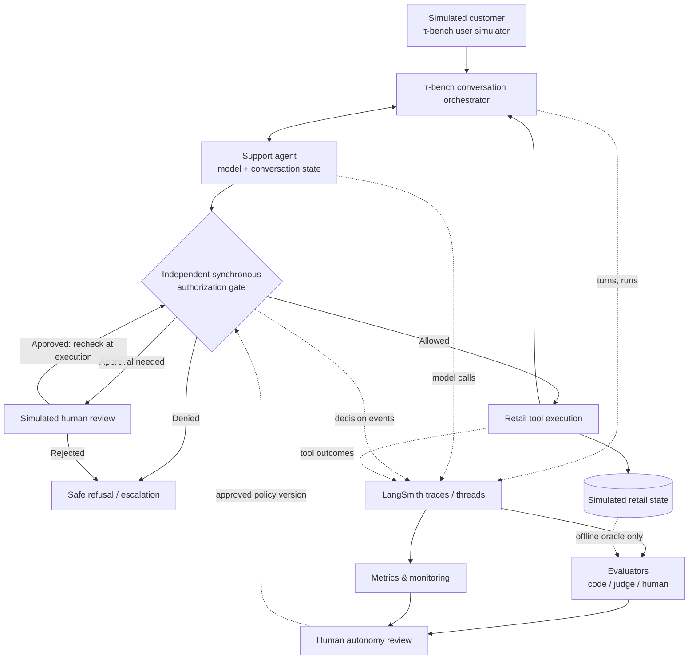
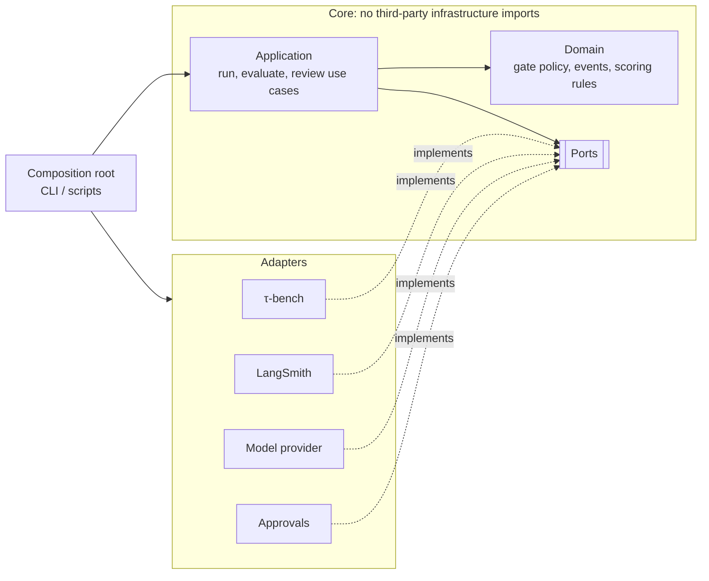
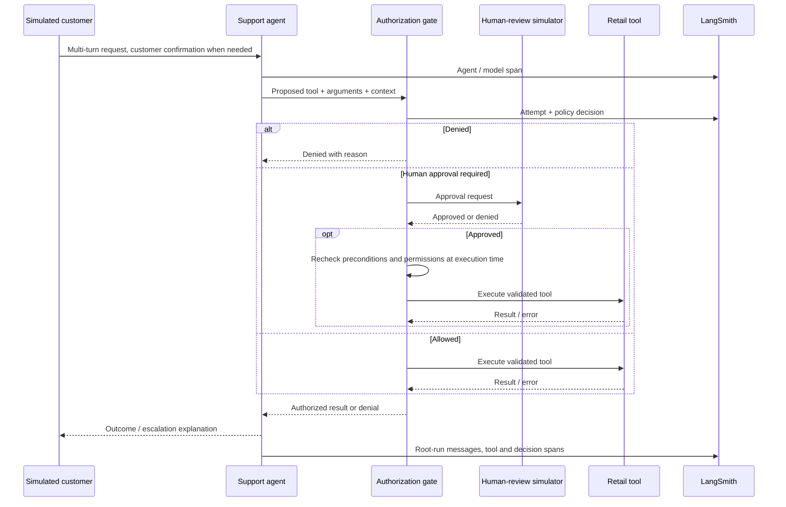

# Architecture and Telemetry Contract

[Home](../README.md) · [Master plan](../DEVELOPMENT.md) · [Autonomy](AUTONOMY.md) · [Evaluation](EVALUATION.md)

**Status:** Target architecture. The [event and identifier contract](#event-and-identifier-contract) is implemented as schema `trace-event/1` with the `TraceSink` port and its [LangSmith adapter](#langsmith-thread-contract); the τ-bench adapters, gate, and evaluators are not implemented yet. τ-bench is pinned at commit `0c69df4`; its result structures and extension points are recorded in [BASELINE.md](BASELINE.md).

## Architectural intent

Use a small, understandable Python project that **adapts τ-bench** rather than copying an entire external application. Keep the upstream benchmark intact for baseline scoring. Apply observability and autonomy controls in our own clearly labeled experimental path.



**Most important trust boundary:** The model can **request** an action but cannot **authorize** its execution. The gate performs an independent validation before invoking a mutating tool.

## Deployment and repository boundaries

```text
workspace/
├── agent-autonomy-lab/       # our single GitHub repo
│   ├── docs/
│   ├── src/                  # added when implementation begins
│   ├── tests/
│   ├── datasets/
│   └── reports/
└── tau2-bench/               # separate upstream clone, pinned commit
```

Clone τ-bench **beside** this repository, never inside it: a nested Git repository would blur version boundaries and risk committing upstream code. A fork or submodule is **not** the starting point. Reassess only after finding a specific limitation. The initial baseline runs directly in upstream. Adapter tests later run from our repository. Configurations must record the upstream version.

## Component responsibilities

| Component | Responsibilities | Must not do |
| --- | --- | --- |
| τ-bench environment/user simulator | Provide tasks, synthetic customer, retail tools/state, original scoring | Be silently altered during baseline reporting |
| Agent adapter | Connect dialogue and tool requests to the benchmark orchestrator; expose trace hooks | Possess authority to bypass execution controls |
| Authorization gate | Validate permissions and mandatory policy preconditions; enforce approve/deny | Infer permission merely from model confidence or an LLM judge score |
| Human-review simulator | Approve/deny designated operational actions deterministically or through explicit review | Substitute for customer confirmation |
| LangSmith adapter | Record correlated runs/threads, child calls and failures | Serve as an authorization mechanism |
| Evaluators | Score final state, events, quality, escalation; maintain evidence trail | Treat unavailable ground truth as negative/positive proof |
| Dashboard and incident workflow | Aggregate quality and operational signals, route investigations | Permit dangerous actions while waiting for async evaluation |

## Code structure: ports and adapters

All lab code follows ports-and-adapters ([ADR-013](DECISIONS.md#adr-013--adopt-the-ports-and-adapters-architecture)). The **core** (domain and application code) defines what it needs as **ports**: small Python interfaces (`typing.Protocol`). **Adapters** implement those ports for one specific technology. A single **composition root** chooses the adapters and wires them together for each run.

**Dependency rule:** dependencies point inward. Domain and application code never imports τ-bench (`tau2`), LangSmith (`langsmith`), or a provider SDK (`openai`, `anthropic`, `litellm`). Only adapters and the composition root import them. From Milestone 3, `import-linter` contracts enforce this rule (see [CONTRIBUTING.md](../CONTRIBUTING.md#architecture)).



### Core ports

| Port | Responsibility | Planned adapters | Test double |
| --- | --- | --- | --- |
| `ToolExecutor` | Execute an already-authorized tool call against the retail environment and return its result or error | τ-bench retail environment (Milestones 3, 6) | In-memory fake retail state |
| `AuthorizationGate` | Decide `ALLOWED`, `DENIED`, or `PENDING_APPROVAL` for a proposed tool call from the autonomy level, policy version, and context | Policy-configured gate in the core (Milestone 6); the port lets wrappers such as tracing decorate it | Fixed-decision stub |
| `TraceSink` | Record runs, spans, and gate events with the [identifier contract](#event-and-identifier-contract), and feedback (scores such as the benchmark reward) on recorded spans | LangSmith (Milestone 3); local JSONL file for offline runs | In-memory recorder |
| `ApprovalSource` | Return a human operational approval or rejection for a pending action | Deterministic fixture (Milestone 6); FastAPI manual-review UI only if Milestone 6 chooses one | Scripted approvals |
| `Evaluator` | Score a completed simulation and return results with evidence IDs ([result format](EVALUATION.md#required-result-format)) | Deterministic code checks; τ-bench reward reader; LLM judge via `ModelClient` (Milestone 4) | Canned results |
| `ModelClient` | Send messages and tool schemas to a model and return its response, token usage, and cost | LiteLLM or provider SDK, e.g. OpenAI `gpt-6-luna` (Milestones 3–4) | Scripted responses |

Ports start minimal and change when their first real adapter is built. The gate's decision logic is domain code; the `AuthorizationGate` port exists so the application layer and the τ-bench adapter depend on an interface, not on one implementation. The `ToolExecutor` port does not enforce authority on its own: Milestone 6 must show that the τ-bench adapter is the **only** route to mutating retail tools and that it runs a call only after the gate allows it.

## End-to-end request sequence



## Event and identifier contract

Trace events follow the versioned schema **`trace-event/1`**, defined in [`src/agent_autonomy_lab/domain/events/`](../src/agent_autonomy_lab/domain/events/) and recorded through the [`TraceSink`](#core-ports) port. Every event carries `schema_version`; a change that removes, renames, or changes the meaning of a field gets a new version, and adding an optional field does not.

### Event types

A trace is a tree of **spans** with gate events attached:

| `event_type` | Span | Parent | Meaning |
| --- | --- | --- | --- |
| `conversation` | yes | none (root) | One τ-bench simulation, recorded as one thread |
| `model_call` | yes | the conversation | One model call by the agent or the simulated user |
| `tool_call` | yes | the conversation | One tool call and its result, including a call the gate rejected |
| `gate` | no | none | One gate state transition. Its `run_id` is the `tool_call` span it annotates, so one call's `ATTEMPTED` → `APPROVED` → `EXECUTED` stay separate events |

Spans are recorded when they finish, so a child is usually recorded before its parent; sinks must not require parents first. `link_errors()` in [`trace_shape.py`](../src/agent_autonomy_lab/domain/events/trace_shape.py) checks the shape, and both `InMemoryTraceSink.link_errors()` and the LangSmith adapter run it: event IDs and span `run_id`s are unique; each simulation has exactly one `conversation` root; every parent is a recorded `conversation` span with the same `RunContext` (which also rules out cycles); and every gate event points at a `tool_call` span for the same tool, with the same `RunContext`. Linked events must share the whole `RunContext`, not only `simulation_id` and `thread_id`, so a child cannot carry a different model, autonomy level, or fault flag from its conversation.

The gate event classes from [AUTONOMY.md](AUTONOMY.md#distinguish-events-and-metrics) are `ATTEMPTED`, `DENIED`, `PENDING_APPROVAL`, `APPROVED`, `EXECUTED`, and `EXECUTION_FAILED`, recorded as separate events so they cannot collapse into a single flag. The schema defines them now; the gate emits them from Milestone 6.

### Fields

"Lab-assigned" means τ-bench at the pinned commit `0c69df4` does not persist the field ([result file structure](BASELINE.md#result-file-structure)), so the lab's adapters set it. Fields from `simulation_id` to `fault_injected` are shared by every event of a simulation (`RunContext`); the rest are per event (`TraceEvent`).

| Field | Purpose | τ-bench source | Example (illustrative) |
| --- | --- | --- | --- |
| `schema_version` | Identify the schema an event follows | lab-assigned | `trace-event/1` |
| `event_id` | Uniquely identify one event; the target of evaluator `evidence_ids` in [EVALUATION.md](EVALUATION.md#required-result-format) | lab-assigned (`new_id()`, UUIDv7; an export of a saved simulation derives it with `stable_id()` so it repeats). A tool result's `id` equals the `tool_calls[].id` it answers, the only persisted link between messages | UUID |
| `event_type` | Span or gate event (see [Event types](#event-types)) | lab-assigned | `tool_call` |
| `timestamp` | When the event happened, in UTC | `messages[].timestamp`, `simulations[].start_time`, local time with no zone, normalized with `to_utc()`; lab clock for lab-only events | `2026-10-27T06:25:09+00:00` |
| `simulation_id` | Correlate one full simulated run | `simulations[].id` (UUID) | UUID |
| `thread_id` | Group multi-turn traces | lab-assigned. Exports use `thread_id_for(simulation_id)`, a UUIDv5, so exporting again reuses the thread; a live run assigns its own before τ-bench creates the `simulation_id` and links them afterwards | UUID |
| `task_id` | Benchmark ground-truth index | `simulations[].task_id` (string, `"0"`–`"113"`) | `"113"` |
| `scenario_id` | Lab scenario definition, when the task comes from one ([SIMULATION.md](SIMULATION.md)) | lab-assigned | `cancellation_missing_confirmation_01` |
| `agent_version`, `prompt_version` | Compare releases | lab-assigned; τ-bench has only `info.agent_info.implementation` (`llm_agent`) | `v1.1`, `prompt-003` |
| `model_id`, `user_model_id` | Agent and user-simulator model provenance | `info.agent_info.llm`, `info.user_info.llm`, per run, not per message | `gpt-6-luna` |
| `tool_schema_version` | Reproduce the tool API surface | lab-assigned: `tool_schema_version()`, the first 12 hex digits of the SHA-256 of the agent's tool schemas in canonical JSON, independent of tool order | `tools-3f9c0a1b2c4d` |
| `policy_version` | Reproduce the policy in force | derived from `info.environment_info.policy` with `policy_version()`: the first 12 hex digits of the SHA-256 of the text, line endings normalized | `policy-8e41d2a07b6c` |
| `autonomy_level` | Active authority at **decision time** | lab-assigned: `0`–`3`, or `"n/a"` when no gate is active (Milestones 3–5). `"n/a"` is **not** level 0: level 0 is a gate that denies every write, while `"n/a"` means no gate decided anything | `"n/a"`, `2` |
| `traffic_type` | Separate synthetic traffic from any other | lab-assigned; only `synthetic` exists | `synthetic` |
| `experiment_class` | Separate the untouched upstream baseline from lab experiments | lab-assigned: `official_upstream_baseline` or `custom_lab_experiment` | `custom_lab_experiment` |
| `fault_injected` | Mark runs with a deliberately injected fault | lab-assigned; `false` unless set | `true` |
| `workflow`, `scenario_category` | Segment evaluations by workflow ([ADR-015](DECISIONS.md#adr-015--map-real-retail-tasks-to-the-three-workflows)) and [scenario category](SIMULATION.md#initial-scenario-taxonomy) | lab-assigned | `cancellation`, `policy_sensitive` |
| `run_id`, `parent_run_id` | Link child spans to their parent | lab-assigned (`new_id()`, UUIDv7, the form LangSmith uses for run IDs). An export of a saved simulation uses `stable_time_id()`, a UUIDv7 whose time is the span's start and whose random bits derive from the simulation and the span, so exporting again sends the same IDs | UUID |
| `turn_index` | Ordered conversation turn | `messages[].turn_idx`; starts at 0 with the fixed opener, and tool calls and tool results each take an index | `6` |
| `tool_name` | Audit which tool was attempted | `tool_calls[].name` | `cancel_pending_order` |
| `argument_hash` | Audit the attempted arguments without storing them in the event | computed from `tool_calls[].arguments` with `argument_hash()`: `sha256:` and the SHA-256 of their canonical JSON. Unsalted, so the same call hashes the same way across runs; it is not redaction | `sha256:…` |
| `gate_event`, `decision`, `decision_reason` | Explain the gate result | lab-assigned by the gate (Milestone 6). `decision` is `ALLOWED`, `DENIED`, or `PENDING_APPROVAL`. A denial is persisted as a tool result with `execution_status: rejected` ([gate boundary](BASELINE.md#authorization-gate-boundary)) | `DENIED`, `missing_customer_confirmation` |
| `outcome` | How a span ended | tool result: `execution_status: executed` with `error: false` → `success`, with `error: true` → `error`; `execution_status: rejected` → `rejected` | `error` |
| `error_class` | Classify a failure | lab-assigned; τ-bench records only `error: true`. Allowed only when `outcome` is `error` | `injected_fault` |
| `error_message` | The error text | tool result `content` (`Error: …`) when `error` is true | `Error: Order not found` |
| `elapsed_ms` | Latency | `generation_time_seconds` × 1000 (agent messages only); `simulations[].duration` × 1000 for the conversation. No per-call timing for the user simulator or tools | `850.0` |
| `prompt_tokens`, `completion_tokens` | Token usage | `messages[].usage` per model call; `null` on the fixed opener | `1200`, `80` |
| `cost` | Model cost in US dollars | `messages[].cost` per model call, computed by LiteLLM during the run; `null` on the fixed opener. The baseline's billed total differs from the sum of these values ([manifest](../reports/m2-baseline/manifest.yaml) `cost.reconciliation`) | `0.0012` |
| `inputs`, `outputs` | Span content for the trace backend: messages, tool arguments, and results | message `content`, `tool_calls[].arguments`, tool result `content`; never `raw_data`. Must be strict JSON (string keys only, so no key can collide on export); copied when the event is built into read-only structures, so neither the caller's objects nor code holding the event can change it; `to_dict()` returns mutable copies. Not part of the identifier contract; adapters redact them before export | `{"messages": […]}` |

The schema enforces these rules when an event is built: every field has its declared type (identifiers are UUIDs, enum fields accept a member or its value, strings are non-empty, and booleans are not accepted as numbers); timestamps are timezone-aware UTC; a `conversation` has no parent and `model_call` and `tool_call` spans need one; `tool_call` and `gate` events need a `tool_name`; gate fields appear only on gate events; `turn_index` and token counts are non-negative integers; and latency and cost are finite and not negative.

Gaps the adapters must fill, from the [baseline reconstruction](BASELINE.md#what-reconstruction-showed): τ-bench timestamps are local time with no zone, so `to_utc()` needs the zone of the machine that ran the simulation (an ambiguous fall-back hour resolves to the earlier instant); the final database is not persisted, so capture end states the lab audits; there is no per-call timing for the user simulator or tools; and each simulation has its own seed (`simulations[].seed`), separate from the run seed.

Example gate event (`to_dict()`, `null` fields and content omitted; illustrative, gates are emitted from Milestone 6):

```json
{
  "schema_version": "trace-event/1",
  "event_id": "019a2a4c-7f10-7c3e-9a41-5d2e8b0c6f13",
  "event_type": "gate",
  "timestamp": "2026-10-27T06:25:41+00:00",
  "simulation_id": "2b7c6a3e-1f4d-4a8e-9b1c-0d2e3f4a5b6c",
  "thread_id": "5f0e3b2a-9c41-5d7e-8a6b-1c2d3e4f5a6b",
  "task_id": "113",
  "run_id": "019a2a4c-7e98-7b21-8f30-2c1d4e5f6a7b",
  "autonomy_level": 2,
  "policy_version": "policy-8e41d2a07b6c",
  "traffic_type": "synthetic",
  "experiment_class": "custom_lab_experiment",
  "fault_injected": false,
  "tool_name": "cancel_pending_order",
  "argument_hash": "sha256:…",
  "gate_event": "DENIED",
  "decision": "DENIED",
  "decision_reason": "missing_customer_confirmation"
}
```

## LangSmith thread contract

[Current multi-turn evaluator documentation](https://docs.langchain.com/langsmith/online-evaluations-multi-turn) specifies that thread-level evaluators require supported **top-level `messages` inputs and outputs** and correlated threads. Model and tool calls are traced as child runs, and the assembled `all_messages` view does not read them: tool calls appear there only because the lab's root messages hold them. The **trajectory** view is available on this account but is incomplete on the lab's traces, so nothing depends on it. See [Thread evaluator validation](#thread-evaluator-validation).

### LangSmith run mapping

[`LangSmithTraceSink`](../src/agent_autonomy_lab/adapters/langsmith/trace_sink.py) buffers events and feedback and exports them on `flush()`. If the buffered events fail `link_errors()`, the feedback fails `feedback_errors()`, or a conversation lacks well-formed `messages`, it raises `TraceShapeError`, sends nothing, and keeps the buffer, so a malformed trace never reaches LangSmith in pieces. Each simulation becomes one trace, sent root first:

| Event | LangSmith run | Mapping |
| --- | --- | --- |
| `conversation` | root `chain` run named `conversation`; `trace_id` is its `run_id` | `inputs` and `outputs` must each hold a non-empty top-level `messages` list in OpenAI chat format (`role`; string or null `content`; assistant `tool_calls` with an `id` and a `function` whose `arguments` are a JSON string; tool messages with a `tool_call_id`) |
| `model_call` | `llm` child run named `model_call` | token counts and cost go to `outputs.usage_metadata` (`input_tokens`, `output_tokens`, `total_tokens`, `total_cost`) |
| `tool_call` | `tool` child run named after the tool | the tool arguments and result as recorded |
| `gate` | not a run | an entry `gate:<class>` in its tool run's `events`, with `event_id`, `gate_event`, `decision`, `decision_reason`, and `argument_hash` |
| `Feedback` (not an event) | feedback on its run, sent after the runs | `key`, `score`, `comment`, and `value` (JSON detail); its `id` is the `feedback_id`; `trace_id` is the root run; `session_id` is the project's ID; `feedback_source.metadata` holds the `RunContext` and `schema_version` |

Every run's metadata carries the event's non-null [fields](#fields) except content and links, including `event_id`, `timestamp`, `simulation_id`, and `thread_id`; LangSmith groups runs into a thread by the `thread_id` metadata key. A span's `timestamp` is its start time; its end time is `timestamp` plus `elapsed_ms` (the start time when latency is unknown). `dotted_order` is built from start times and run IDs. LangSmith rejects a run whose start time is more than 24 hours from now, so a trace whose root started more than 23 hours ago (or ahead) is **shifted whole**: its root starts at export time and every span keeps its offset from the root. The real time stays in metadata `timestamp`, so filter and sort on that, not on the LangSmith start time, when a trace may have been shifted ([ADR-017](DECISIONS.md#adr-017--shift-old-traces-to-export-time-in-the-langsmith-adapter)). Before shifting a trace, the sink asks LangSmith which of its runs are already stored. If the root is stored, its stored start time is the anchor and only missing runs are sent, so a retry after a partial upload lines up with what was stored and a full re-export sends no runs. A missing run that the stored anchor would still place more than 24 hours from now cannot be sent; `flush` raises `StaleTraceError` before sending anything. After a failed export, wait a minute before retrying: LangSmith may not yet return runs it has just stored, and a lookup that misses the stored root would pick a new shift for the missing runs.

Run and feedback IDs come from the events. LangSmith answers a known run ID with a 409 conflict, which the SDK ignores, and replaces feedback that has a known ID, so sending the same events twice adds nothing. With `auto_batch_tracing` on (the SDK default), runs are sent in the background and a rejected run is only logged, so callers that must know every run arrived, such as the export below, pass a client with `auto_batch_tracing=False`. A span with `outcome` `error` becomes an error-status run whose `error` is `<error_class>: <error_message>`, with `error_class` also in metadata; its outputs are kept. Content is exported as recorded apart from redaction (below).

#### What reaches LangSmith

- **Synthetic tag.** Every run's metadata and every feedback item's `feedback_source.metadata` carry `traffic_type: synthetic` from the `RunContext`.
- **Secrets.** The sink passes every argument of every run and feedback item (content, metadata, errors, gate events, and feedback `source_info` alike) through a [`Redactor`](../src/agent_autonomy_lab/adapters/langsmith/redaction.py) before sending, rather than a list of fields that could miss one. It replaces a secret with `[SECRET_DETECTED]` by three rules: the exact value of any environment variable with a secret name (`*_API_KEY`, `*_TOKEN`, `*_SECRET`, `*_PASSWORD`, …; importing τ-bench loads the working directory's `.env`, so these are the keys the process holds), in mapping keys as well as values, and also JSON-escaped once, as it appears inside a tool call's JSON-string `arguments`; the LangSmith SDK's `DEFAULT_SECRET_RULES` (provider key formats, `Authorization` and `Bearer` headers, secret-named assignments, credentials in URLs); and the whole value under a secret-named key such as `api_key`, `authorization`, `x-api-key`, `cookie`, `access_token`, or `accessToken` (components split at `_`, `-`, and camelCase boundaries; `prompt_tokens` and `maxTokens` are not secret names). The SDK adds metadata of its own after the sink hands a run over (some `LANGSMITH_*` variables and a git revision), so entrypoints build the client with `langsmith_client()`, which installs the same redactor as the client's `anonymizer`. The SDK's `extra.runtime` (SDK, Python, and platform versions and CI commit SHAs, a fixed set with no credentials) does not pass through it. The API key travels only in the request header. Redaction changes nothing in the Milestone 2 baseline's export (checked offline with the developer's `.env` loaded): no baseline content looks like a secret.
- **Answer key.** The lab never copies the task's `user_scenario` or `evaluation_criteria`; only τ-bench's user simulator and evaluator read them. The reward checks (`nl_assertions` and `action_checks`, which hold the reference actions) are the answer key: they go only into feedback on the root, the evaluation attachment, never into a run the agent could see. Leak tests send the saved-run export and a live trace through the real SDK with a fake HTTP session and check every request body; they plant fake keys in span content, a mapping key, JSON-escaped tool arguments, the run context, errors, gate events, feedback, and SDK-copied metadata, and sentinel strings in the fixture's hidden scenario, NL assertions, and a reference action the agent never took.

### Exporting a saved simulation (hook D)

A saved τ-bench run can be exported after the fact, with no model calls ([hook D](BASELINE.md#langsmith-hook-points)). The [results reader](../src/agent_autonomy_lab/adapters/tau2/results_reader.py) parses `results.json` into the lab's [simulation records](../src/agent_autonomy_lab/domain/simulations.py), and the [export use case](../src/agent_autonomy_lab/application/export_simulation.py) records each simulation in a `TraceSink`:

```bash
uv run --env-file .env python -m agent_autonomy_lab.entrypoints.export_simulation \
    m2-baseline-2026-10-27-r3 --source-tz America/Denver \
    --experiment-class official_upstream_baseline
```

`RUN` is a `--save-to` name under `$TAU2_DATA_DIR/simulations`, or a path to a `results.json` or its directory. `--source-tz` is the zone of the machine that ran the simulations (τ-bench writes local time with no zone; the Milestone 2 baseline ran in `America/Denver`). `--dry-run` builds the traces in an `InMemoryTraceSink`, applies the same offline checks the LangSmith sink applies before sending (`shape_errors()`: links, feedback, and the conversation message format), and sends nothing.

| τ-bench | Exported as |
| --- | --- |
| simulation | one `conversation` root; `thread_id` is `thread_id_for(simulation_id)`; `elapsed_ms` is `duration`. `inputs.messages` hold the transcript up to and including the first customer message and `outputs.messages` the rest, so together they are the whole conversation in OpenAI chat format. If nothing follows that message, or no customer message exists, the last message moves to the outputs so neither side is empty. A simulation with fewer than two messages has no conversation to show: it is skipped, and the command lists it with the reason, while the rest of the run is exported |
| message with `usage` or `cost` (agent or simulated user) | one `model_call` child: `turn_index`, tokens, cost, and the message as `outputs.messages`. An agent call starts `generation_time_seconds` before its message's timestamp; a user call has no timing. The fixed opener is not a model call |
| tool result | one `tool_call` child named after the tool, with the call's arguments as `inputs`, the result `content` as `outputs`, and `argument_hash`; `outcome` from `execution_status` and `error` (`error_message` is the content). τ-bench records no tool timing |
| `reward_info` | feedback on the root, never in the messages: `reward` (score; `value` holds `reward_basis`, `reward_breakdown`, `termination_reason`, `db_check`, `nl_assertions`, `action_checks`, and `env_assertions`) and one `reward_<component>` per breakdown component, such as `reward_db` |
| run `info` | `RunContext`: `model_id`, `user_model_id`, `agent_version` (`agent_info.implementation`), `policy_version` (from `environment_info.policy`); `autonomy_level` `"n/a"`; `experiment_class` from the command line |

Not exported: `raw_data` (the full provider response), the task's hidden user instructions, and the policy text (only its version). Every event, run, and feedback ID derives from the simulation, so exporting the same run again with the same `--source-tz` adds no threads, runs, or feedback; a different zone moves the timestamps the run IDs are built from and would duplicate the runs. To find a simulation in LangSmith, type `metadata.simulation_id:<id>` in the project's search bar (the sidebar's metadata list does not show every key), or open its thread by `thread_id`.

### Tracing a live run (hook A)

A live run goes through a lab agent registered with τ-bench's `register_agent_factory` ([hook A](BASELINE.md#langsmith-hook-points)). [`TracedAgentFactory`](../src/agent_autonomy_lab/adapters/tau2/traced_agent.py) builds upstream's `LLMAgent` with upstream's `create_llm_agent` and wraps it in a `TracedAgent`, which forwards every call unchanged and records, as lab [records](../src/agent_autonomy_lab/domain/agent_turns.py), what passed through: the transcript, each agent turn's input messages, reply, timing, and any exception, and a **fingerprint** of what the agent sent its model besides the conversation (`prompt_version`, `tool_schema_version`, and `model_args_version` hashes). [`live_run`](../src/agent_autonomy_lab/adapters/tau2/live_run.py) runs one task through τ-bench's public `get_tasks` and `run_single_task`; τ-bench itself is not modified.

```bash
uv run --env-file .env --env-file ../tau2-bench/.env \
    python -m agent_autonomy_lab.entrypoints.trace_live_run --task-id 0
```

Every default matches the [Milestone 2 baseline run](../reports/m2-baseline/manifest.yaml) (`gpt-6-luna` through `openai/responses/`, `reasoning_effort: medium` for agent and user, run seed 42, so trial seed 670487, as `tau2 run` derives it). The second `--env-file` supplies `OPENAI_API_KEY`, which lives only in the τ-bench checkout. The run calls the model, so it costs money. τ-bench's `SimulationRun` and a JSON summary go to `$TAU2_DATA_DIR/simulations/<--save-to>/`, outside the repository; `--dry-run` runs the task and checks the trace but sends nothing.

**Same requests as the baseline agent.** Before the run, the entrypoint builds upstream's `llm_agent` for the same task and seed with τ-bench's own `build_text_orchestrator` (no model call) and fingerprints it. Each traced turn's fingerprint must equal it, or the command exits 1. The summary lists the reference and, for each turn that differs, the values it sent.

**Linking to the simulation.** The agent factory never receives the simulation ID; τ-bench assigns it inside `run_single_task`. The wrapper buffers its recording, and [`trace_live_run`](../src/agent_autonomy_lab/application/trace_live_run.py) builds the trace after the run from the recording and the returned `SimulationRun`:

| Recorded | Traced as |
| --- | --- |
| simulation | one `conversation` root, timed by the wrapper from the agent's first state to `stop`; `thread_id` is `thread_id_for(simulation_id)`, as in the export; the transcript split into `inputs.messages` and `outputs.messages` as in the export |
| agent turn | one `model_call` child: `turn_index` (the reply's position in the transcript, which equals τ-bench's `turn_idx`), start time and `elapsed_ms` measured around the delegated call, tokens and cost from the reply, `inputs` holding the messages the turn answered plus `model`, `model_args`, and the turn's own `prompt_version`, `tool_schema_version`, and `model_args_version`, the reply as `outputs.messages`. A call that raised is an `error` span with `error_class` (the exception type) and `error_message` |
| simulated-user message with usage | one `model_call` child, as in the export (no timing) |
| tool result | one `tool_call` child, as in the export: the tool result arrives as the next turn's input; τ-bench records no tool timing ([hook E](BASELINE.md#langsmith-hook-points) would add it) |
| `reward_info` | feedback on the root, as in the export |
| run settings | `RunContext`: `experiment_class` `custom_lab_experiment`, `traffic_type` `synthetic`, `autonomy_level` `"n/a"`, `agent_version` (the registered agent name, `lab_traced_llm_agent`), `user_model_id`, `policy_version` from the environment's policy, as in the export, and `model_id`, `prompt_version`, and `tool_schema_version` when every turn sent the same value (otherwise unset, and only the turns' spans carry them) |

**Runs that raise.** τ-bench's runner does not catch an exception from the agent, the simulated user, or the model provider: `run_single_task` propagates it and returns no `SimulationRun`, and the simulation ID it assigned is never exposed. The partial conversation is still traced. The entrypoint gives it a lab-assigned `simulation_id` of the form `unfinished-<UUIDv7>`, which can never be mistaken for a τ-bench ID, and makes the root an `error` span whose `error_class` and `error_message` describe the exception. A turn whose model call raised is its own `error` span, and there is no reward feedback. The summary records the failure, nothing is written as `simulation.json`, and the command exits 1. A run that fails before the customer's first message has no conversation to trace and is reported only.

The agent's copy of the policy ends with τ-bench's language clause ("Respond in English using Latin script; …"), so it hashes differently from the environment policy; `policy_version` names the retail policy in both hooks, and `prompt_version` covers the text the agent actually received. Live trace IDs include `live`, so they never collide with an export of the same simulation; a live run is traced by hook A only, and exporting it with hook D as well would add a second conversation root to its thread.

**Overhead.** The wrapper times its own work separately from the agent calls it delegates: fingerprinting and converting messages during the run (in the loop, so it adds to conversation latency), then building and sending the trace after the run returns (outside the conversation). A traced-versus-untraced wall-clock comparison would not isolate this, because reasoning models do not repeat a conversation from a seed. Measured values are in [`reports/m3-traces/manifest.yaml`](../reports/m3-traces/manifest.yaml).

### Deterministic replay (behavioral equivalence)

Observability must not change behavior. Reasoning models do not repeat a conversation from a seed, so two live runs cannot show it: they differ whether tracing is on or not. Instead, one live run is recorded as a **cassette** of every model response, and the compared runs replay it. A replay that sends any request the recording does not have fails, so a traced run that matches the cassette sent exactly what the untraced run sent.

```bash
# 1. Record (live; calls the models). The cassette is written once and never overwritten.
uv run --env-file .env --env-file ../tau2-bench/.env \
    python -m agent_autonomy_lab.entrypoints.cassette_run record \
    --cassette cassettes/m3-07-task-0.cassette.json --save-to m3-07-record
# 2. Replay with tracing off: upstream's LLMAgent, unwrapped; nothing recorded or sent.
uv run --env-file .env python -m agent_autonomy_lab.entrypoints.cassette_run replay \
    --cassette cassettes/m3-07-task-0.cassette.json --save-to m3-07-replay-off
# 3. Replay with tracing on: the traced lab agent, sent to LangSmith.
uv run --env-file .env python -m agent_autonomy_lab.entrypoints.trace_live_run \
    --replay cassettes/m3-07-task-0.cassette.json --save-to m3-07-replay-on
# 4. Compare (the first run is the reference); exits 1 on any difference.
uv run python -m agent_autonomy_lab.entrypoints.compare_outcomes \
    ../tau2-bench/data/simulations/m3-07-replay-{off,on} ../tau2-bench/data/simulations/m3-07-record
```

**Where the recording happens.** The [cassette transports](../src/agent_autonomy_lab/adapters/litellm/cassette.py) plug into LiteLLM's HTTP layer. `litellm.sync_transport` is used by every synchronous HTTP client LiteLLM builds itself, which covers the OpenAI Responses bridge (the baseline's agent and user, and τ-bench's NL-assertion judge) and Anthropic (its review judges). `litellm.client_session` is used by the OpenAI SDK client behind plain chat completions. With both set, the transports see each provider request as sent, from the agent, the simulated user, and the benchmark's judges alike, and τ-bench is not changed. Async calls are not covered; τ-bench calls LiteLLM synchronously. A cassette stores each request's method, URL, and body and each response's status, content type, and body; no headers, so no API key. The replay serves the responses in order and fails on the first request that differs or comes after the end. It then fails every later request, so LiteLLM's retries cannot skip a mismatch. Afterwards the entrypoint checks that every response was served, because τ-bench's evaluator catches some judge errors. During a replay, provider keys are replaced by a placeholder, so a request that bypassed the transport would be refused instead of billed. A LiteLLM custom provider was tried first and rejected: LiteLLM drops parameters a custom provider does not declare, such as `reasoning_effort`, so it would not have seen the baseline's request.

**What is compared.** Each run writes `outcome.json` with a [`RunOutcome`](../src/agent_autonomy_lab/domain/equivalence.py): the transcript (every message's role, content, tool calls with arguments, and tool-result fields), the agent's messages and tool calls by name, the final database hash, the termination reason, and the reward with its breakdown and the checks behind it. The database hash is read from the run's **live** environment after the conversation: both agent factories keep the toolkit their agent's tools are bound to. The evaluator's own replays use fresh environments. Timing, cost, and IDs are not compared, because they differ between any two runs. `compare_outcomes` reports each field and whether it equals the reference. Requests, settings, and outcomes are all compared as canonical JSON, because Python's `==` treats `true`, `1`, and `1.0` as equal and JSON does not.

**Settings.** A cassette stores the run settings it was recorded with, and a replay refuses different ones. Model arguments are an allowlist of tuning parameters (`MODEL_ARGS` in [`run_options.py`](../src/agent_autonomy_lab/entrypoints/run_options.py): `reasoning_effort`, `temperature`, `top_p`, `max_tokens`, `max_completion_tokens`, `seed`, `parallel_tool_calls`, `stop`, `drop_params`, `num_retries`). LiteLLM accepts credentials through many of its arguments (`api_key`, `extra_headers`, `headers`, `api_base`), so every other argument is refused and keys come from the environment; a cassette's settings and a trace's `model_args` can hold no key. A cassette run (record or replay) also accepts only models whose provider is one the transports are tested on, OpenAI or Anthropic (`COVERED_PROVIDERS`): another provider's client might bypass them, so a recording would miss its calls and a replay could reach the provider. Every default matches the Milestone 2 baseline. The recorded requests show what those settings send. With the pinned LiteLLM, the `openai/responses/` bridge sends neither setting. `gpt-6-luna` is missing from LiteLLM's model map, so LiteLLM treats `reasoning_effort` as unsupported and τ-bench's `drop_params` removes it (without `drop_params` the call raises `UnsupportedParamsError`; a model in the map, such as `gpt-5.4-mini`, gets `reasoning.effort`). The bridge sends no `seed` for any model. The model's responses report `effort: medium`, its default. The baseline's declared `reasoning_effort: medium` therefore matches what ran, but only because it is the default. Results are in [`reports/m3-traces/`](../reports/m3-traces/).

**Rechecking on upgrade.** The replay relies on two internals. Recheck them after upgrading `litellm` or `tau2`; the offline tests in `tests/test_cassette.py` and `tests/test_deterministic_replay.py` fail if either breaks:

| Relies on | Observed (LiteLLM 1.81.11, τ-bench `0c69df4`) | If it changes |
| --- | --- | --- |
| `litellm.sync_transport`, `litellm.client_session` | `HTTPHandler` reads `sync_transport` when it builds a client (Responses bridge, Anthropic); the OpenAI SDK client for chat completions uses `client_session` | Requests bypass the cassette: recording misses them, and a replay fails authentication with the placeholder key. `test_every_provider_route_reaches_the_transport` checks each route |
| `Environment.get_response` | the orchestrator calls it through its environment instance, so an attribute set on that instance replaces it; the evaluator builds its own environments | If calls stop going through the instance, the fault never fires and `--inject-fault` exits 1. If the evaluator starts reusing the run's environment, the wrapper could reach evaluation |
| `Tool._func.__self__` | the agent's tools are bound methods of the live environment's toolkit | The final database hash cannot be read: `live_toolkit()` returns `None`, the untraced run raises, and a traced run writes no `outcome.json` |

### Injecting a tool failure

The Milestone 2 baseline had no tool errors, so a failure has to be provoked to show it can be inspected. `--inject-fault` makes one live run fail the first call to one read tool:

```bash
uv run --env-file .env --env-file ../tau2-bench/.env \
    python -m agent_autonomy_lab.entrypoints.trace_live_run \
    --task-id 0 --inject-fault get_order_details --save-to m3-08-fault-task-0
```

[`OneShotToolFault`](../src/agent_autonomy_lab/adapters/tau2/fault_injection.py) wraps `get_response` on the one `Environment` object the run's orchestrator holds. τ-bench is not modified, and the wrapper is never registered, so `retail` still builds unwrapped environments for the evaluator and every other run. To reach that object before the run starts, a fault run calls `build_text_orchestrator` and `run_simulation`, the public layers `run_single_task` is built on, instead of `run_single_task` itself.

| Rule | Why |
| --- | --- |
| Only read tools | Evaluation replays a trajectory in fresh environments and skips non-mutating calls, so the final database and reward replay never see the failed call. A write or an unknown tool is refused before any model call |
| First call only | Later calls pass through, so the agent has a real chance to recover |
| The agent sees `Error: Service temporarily unavailable` | Nothing in it says the failure was deliberate. `error_class` goes to the trace, never to the agent |
| Fired, or nothing is traced | If the agent never calls the tool, nothing was injected: the command says so, sends nothing, and exits 1. A run that raises is traced as [any other](#tracing-a-live-run-hook-a), and is labeled `fault_injected` only if the fault had fired |
| Live only | `--replay` with `--inject-fault` is refused: a replay must match its cassette |

**In the trace.** The failed call is a `tool_call` span with `outcome: error`, `error_class: injected_fault`, and the arguments as inputs, under the conversation root like any tool span. Every span of the run has `fault_injected: true`, so these runs can be filtered out. The next agent turn's `model_call` holds the failure in its inputs. The failed call's tool span ID, `fault.tool_run_id` in `summary.json`, serves as the injection ID that [`SIMULATION.md`](SIMULATION.md#safe-failure-injection-optional-after-baseline) asks for. What one run showed is in [`reports/m3-traces/tool-failure-observation.md`](../reports/m3-traces/tool-failure-observation.md).

### Thread evaluator validation

Checked on October 30, 2026 (America/Denver) with two LLM-as-a-judge thread evaluators on the project (Personal organization, GCP US, Developer plan), both using `claude-haiku-5-5`, a different provider from the agent. They ask the same question, "Did the assistant address the customer's request by the end?", and differ only in the view they receive. IDs and costs are in [`manifest.yaml`](../reports/m3-traces/manifest.yaml) (`thread_evaluator_validation`).

Two threads were judged by both evaluators:

- **A real conversation:** a [replay](#deterministic-replay-behavioral-equivalence) of task `0`, sent through the normal traced path.
- **A marker thread:** [`thread_probe`](../src/agent_autonomy_lab/entrypoints/thread_probe.py) sends a small synthetic thread. A real root already holds its tool calls, so it cannot show whether a view reads child spans. The marker thread keeps `PROBE-ROOT-MESSAGE` in the root's messages, and `PROBE-CHILD-MODEL` and `PROBE-CHILD-TOOL` only in child spans.

| View | Task `0` replay (22 messages, 6 tool calls, 6 tool results) | Markers received | Score on the replay |
| --- | --- | --- | --- |
| `all_messages` | All 22 messages, in order, with equal content, including the 6 tool calls and 6 tool results | Root only | 1.0 |
| `trajectory` | 8 entries: 4 of 5 customer messages, 4 of 10 agent turns, 3 of the 6 tool calls, none of the tool results, and no final reply to the customer | `PROBE-CHILD-MODEL` only | 1.0 |

Both evaluators ran without a schema error. The counts come from each judge run's input, read through the API. Screenshots of the verdicts and the judges' reasoning: [`all_messages`](../reports/m3-traces/screenshots/m3-09-all-messages.png), [`trajectory`](../reports/m3-traces/screenshots/m3-09-trajectory.png), and [the marker thread's `trajectory`](../reports/m3-traces/screenshots/m3-09-probe-trajectory.png).

- **Child tool spans do not appear in `all_messages`.** Its tool calls and results come from the root's messages, as the [multi-turn docs](https://docs.langchain.com/langsmith/online-evaluations-multi-turn) describe. A tool call that reached only a child span would be invisible to this view, so a thread judge sees what the root holds.
- **`trajectory` is available here, but incomplete on the lab's traces.** The docs limit it to GCP US on LangSmith Cloud, and it saved and ran on this account; the docs name no plan limit. They also say it keeps tool calls and results, which is not what these traces produced. In the replay, it kept exactly the agent turns that answered a customer message, and it dropped every turn that answered a tool result. The lab's agent spans hold only the messages that turn answered, and its tool spans carry no `tool_call_id`, which may be the reason; this was not tested.
- **A partial view can still score 1.0.** The trajectory judge wrote that the trajectory "ends at the tool call with no returned result or final message to the customer shown", and it passed the conversation anyway. Equal scores here do not mean the views are equivalent.
- **The judge's input held no answer key.** `evaluation_criteria`, `user_scenario`, `nl_assertions`, `action_checks`, and `reward` do not appear in any of the four judge inputs.

**Fallback.** Thread judges use `all_messages`. Checks that need tool calls, arguments, or results read the tool spans or the root's messages directly, in deterministic evaluators, and do not use `trajectory`. Using `trajectory` later would first need the lab's span shape tested against it.

Setup points that will catch the next person:

- **Anthropic judges need a Human message.** A prompt with only a System message fails with `400 messages: at least one message is required`, and the error is stored as feedback with no score. The first attempt, with System-only prompts, failed this way on both threads.
- **Thread evaluators see only later threads.** A failed run needs a new thread, because a `trajectory` evaluator cannot backfill. A cassette replay gives one with no agent or simulated-user model calls.
- **Timing.** With the project's idle time set to the 2-minute minimum, feedback arrived about 3 minutes after the threads were sent.
- **Saving a rule adds to the workspace.** Each evaluator also created an `Alignment` code rule and a corrections dataset.
- **Retention stays on the 14-day tier only if you opt out.** Both evaluators have 180-day retention off, and the project remains `shortlived`.
- **Evaluators judge every new thread.** Sampling and filters limit this, and a spend limit caps it ($5 a week here). The two evaluators were disabled after this check, so later runs are not judged by accident.

### Rechecking LangSmith behavior on upgrade

The adapter relies on behavior we observed against the live service and SDK, not only on our own code. The tests run the real `langsmith.Client` with a fake HTTP session, so they catch a change in what the SDK sends, but not in how the service answers. Recheck these after upgrading `langsmith` or when LangSmith announces API changes:

| Behavior | Observed (October 2026, SDK 0.14.14) | If it changes |
| --- | --- | --- |
| Start-time window | `422` for a start time more than 24 hours from now | Revisit [ADR-017](DECISIONS.md#adr-017--shift-old-traces-to-export-time-in-the-langsmith-adapter) and `MAX_CLOCK_DISTANCE` |
| Known run ID | `409 Run create payload already received`; `Client.create_run` ignores the conflict | Re-exports could duplicate or fail |
| Known feedback ID | replaced (`200`) | Re-exports could duplicate feedback |
| Background batching | with `auto_batch_tracing` on, rejected runs are only logged | The export may stop needing a synchronous client |
| Stored-run lookup | `client.runs.query_v2` (async on the sync client) by `trace_id` returns a trace's runs with no time window | Retries of shifted traces lose their anchor |
| Thread messages | thread evaluators read top-level `messages` in OpenAI chat format ([multi-turn docs](https://docs.langchain.com/langsmith/online-evaluations-multi-turn)), and `all_messages` holds root messages only ([validated](#thread-evaluator-validation)); this rule is the lab's own check, LangSmith accepts any JSON | Update `message_errors()` |
| Trajectory view | runs on this account; on lab traces it omits tool results and most agent turns ([validated](#thread-evaluator-validation)) | Rerun `thread_probe` and a replay before relying on it |

To recheck, export the Milestone 2 baseline to a scratch project (set `LANGSMITH_PROJECT`), export it again, and confirm with the API that the project holds five threads, one root each, the same run counts as the first export, and three feedback items per root.

Acceptance test: one task is navigable as a complete conversation; its child spans include tool invocations; a thread-level evaluator can consume the assembled messages without schema errors.

Multi-turn online evaluation can be delayed after conversation inactivity. **The authorization gate executes synchronously regardless of the evaluator's timing.**

## Data handling

- Synthetic customer records only; no real PII or actual transaction APIs.
- Never commit `.env`, API keys, client secrets, provider payloads that might contain sensitive information, or raw traces without review.
- Keep simulator oracle goals/final-state expectation separate from messages available to the agent.
- Store experiment run manifests and sanitized examples in the repository; link to larger artifacts in LangSmith when access permits.
- Add consistent metadata to separate `official_upstream_baseline` from `custom_lab_experiment`.

## Design and integration risks

- **Benchmark drift:** Pin upstream code/tasks. Recent τ-bench releases changed grading in some domains; comparisons require matching versions.
- **Tool interception:** Confirm the true retail tool execution boundary before building the gate. An agent-only wrapper may not cover all paths.
- **Trace shape:** Root-level messages and child-run spans require correct nesting and correlation.
- **Latency/cost:** Instrumentation and judges incur overhead; show measured values by agent version.
- **Platform availability:** Some LangSmith widgets/trajectory features vary by deployment. Demonstrate core trace and scoring functionality before depending on an optional feature.

## Referenced upstream extension points

- [τ-bench repository and setup](https://github.com/sierra-research/tau2-bench)
- [Runnable custom agent examples](https://github.com/sierra-research/tau2-bench/blob/main/examples/agents/README.md), including `HalfDuplexAgent` and orchestrator examples.
- [τ-bench task evaluation contract](https://github.com/sierra-research/tau2-bench/blob/main/docs/evaluation.md)
- [LangSmith multi-turn evaluators](https://docs.langchain.com/langsmith/online-evaluations-multi-turn)
