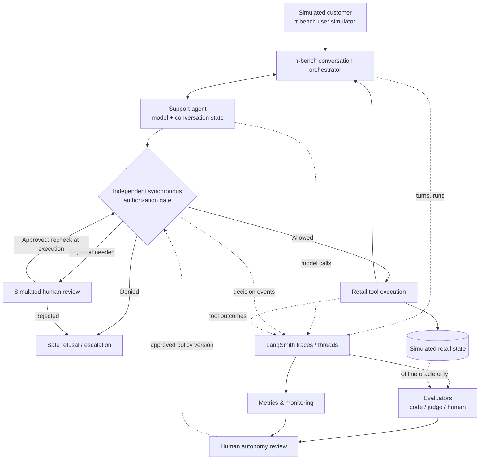
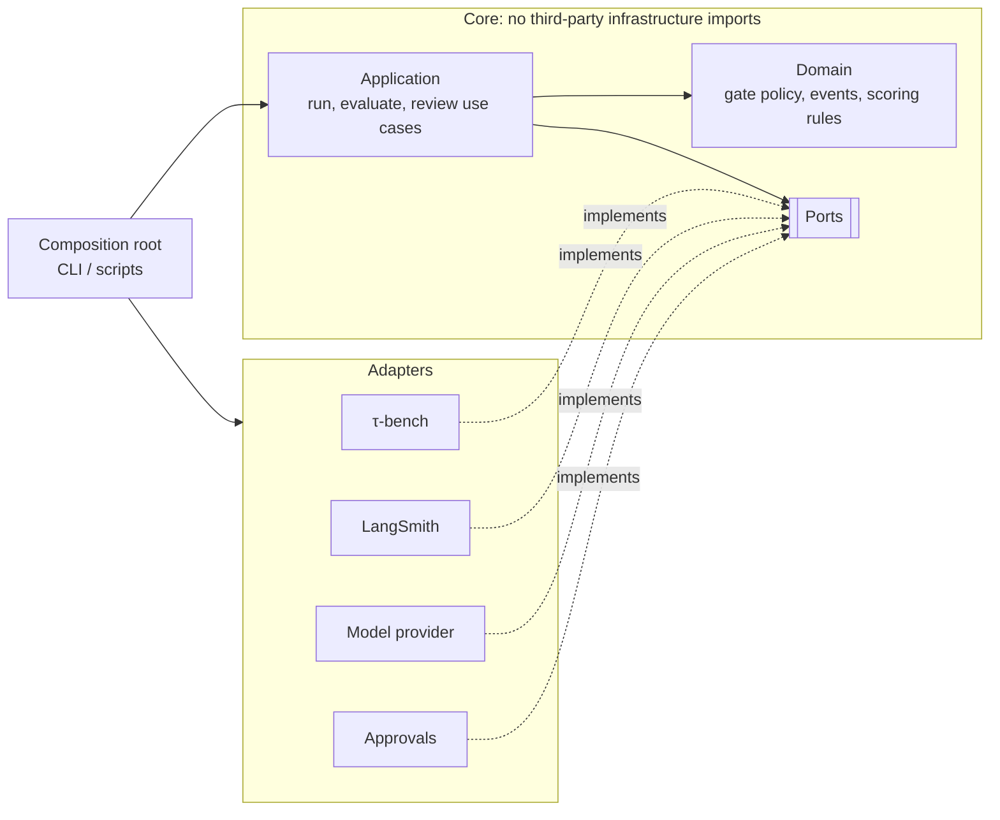
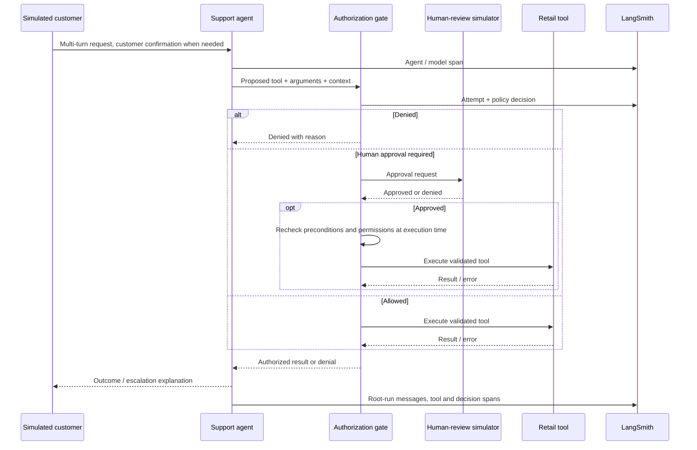

# Architecture and Telemetry Contract

[Home](../README.md) · [Master plan](../DEVELOPMENT.md) · [Autonomy](AUTONOMY.md) · [Evaluation](EVALUATION.md)

**Status:** Target architecture, not implemented. τ-bench is pinned at commit `0c69df4`; its result structures and extension points are recorded in [BASELINE.md](BASELINE.md).

## Architectural intent

Use a small, understandable Python project that **adapts τ-bench** rather than copying an entire external application. Keep the upstream benchmark intact for baseline scoring. Apply observability and autonomy controls in our own clearly labeled experimental path.



**Most important trust boundary:** The model can **request** an action but cannot **authorize** its execution. The gate performs an independent validation before invoking a mutating tool.

## Deployment and repository boundaries

```text
workspace/
├── agent-autonomy-lab/       # our single GitHub repo
│   ├── docs/
│   ├── src/                  # added when implementation begins
│   ├── tests/
│   ├── datasets/
│   └── reports/
└── tau2-bench/               # separate upstream clone, pinned commit
```

Clone τ-bench **beside** this repository, never inside it: a nested Git repository would blur version boundaries and risk committing upstream code. A fork or submodule is **not** the starting point. Reassess only after finding a specific limitation. The initial baseline runs directly in upstream. Adapter tests later run from our repository. Configurations must record the upstream version.

## Component responsibilities

| Component | Responsibilities | Must not do |
| --- | --- | --- |
| τ-bench environment/user simulator | Provide tasks, synthetic customer, retail tools/state, original scoring | Be silently altered during baseline reporting |
| Agent adapter | Connect dialogue and tool requests to the benchmark orchestrator; expose trace hooks | Possess authority to bypass execution controls |
| Authorization gate | Validate permissions and mandatory policy preconditions; enforce approve/deny | Infer permission merely from model confidence or an LLM judge score |
| Human-review simulator | Approve/deny designated operational actions deterministically or through explicit review | Substitute for customer confirmation |
| LangSmith adapter | Record correlated runs/threads, child calls and failures | Serve as an authorization mechanism |
| Evaluators | Score final state, events, quality, escalation; maintain evidence trail | Treat unavailable ground truth as negative/positive proof |
| Dashboard and incident workflow | Aggregate quality and operational signals, route investigations | Permit dangerous actions while waiting for async evaluation |

## Code structure: ports and adapters

All lab code follows ports-and-adapters ([ADR-013](DECISIONS.md#adr-013--adopt-the-ports-and-adapters-architecture)). The **core** (domain and application code) defines what it needs as **ports**: small Python interfaces (`typing.Protocol`). **Adapters** implement those ports for one specific technology. A single **composition root** chooses the adapters and wires them together for each run.

**Dependency rule:** dependencies point inward. Domain and application code never imports τ-bench (`tau2`), LangSmith (`langsmith`), or a provider SDK (`openai`, `anthropic`, `litellm`). Only adapters and the composition root import them. From Milestone 3, `import-linter` contracts enforce this rule (see [CONTRIBUTING.md](../CONTRIBUTING.md#architecture)).



### Core ports

| Port | Responsibility | Planned adapters | Test double |
| --- | --- | --- | --- |
| `ToolExecutor` | Execute an already-authorized tool call against the retail environment and return its result or error | τ-bench retail environment (Milestones 3, 6) | In-memory fake retail state |
| `AuthorizationGate` | Decide `ALLOWED`, `DENIED`, or `PENDING_APPROVAL` for a proposed tool call from the autonomy level, policy version, and context | Policy-configured gate in the core (Milestone 6); the port lets wrappers such as tracing decorate it | Fixed-decision stub |
| `TraceSink` | Record runs, spans, and gate events with the [identifier contract](#event-and-identifier-contract) | LangSmith (Milestone 3); local JSONL file for offline runs | In-memory recorder |
| `ApprovalSource` | Return a human operational approval or rejection for a pending action | Deterministic fixture (Milestone 6); FastAPI manual-review UI only if Milestone 6 chooses one | Scripted approvals |
| `Evaluator` | Score a completed simulation and return results with evidence IDs ([result format](EVALUATION.md#required-result-format)) | Deterministic code checks; τ-bench reward reader; LLM judge via `ModelClient` (Milestone 4) | Canned results |
| `ModelClient` | Send messages and tool schemas to a model and return its response, token usage, and cost | LiteLLM or provider SDK, e.g. OpenAI `gpt-6-luna` (Milestones 3–4) | Scripted responses |

Ports start minimal and change when their first real adapter is built. The gate's decision logic is domain code; the `AuthorizationGate` port exists so the application layer and the τ-bench adapter depend on an interface, not on one implementation. The `ToolExecutor` port does not enforce authority on its own: Milestone 6 must show that the τ-bench adapter is the **only** route to mutating retail tools and that it runs a call only after the gate allows it.

## End-to-end request sequence



## Event and identifier contract

Trace events follow the versioned schema **`trace-event/1`**, defined in [`src/agent_autonomy_lab/domain/events/`](../src/agent_autonomy_lab/domain/events/) and recorded through the [`TraceSink`](#core-ports) port. Every event carries `schema_version`; a change that removes, renames, or changes the meaning of a field gets a new version, and adding an optional field does not.

### Event types

A trace is a tree of **spans** with gate events attached:

| `event_type` | Span | Parent | Meaning |
| --- | --- | --- | --- |
| `conversation` | yes | none (root) | One τ-bench simulation, recorded as one thread |
| `model_call` | yes | the conversation | One model call by the agent or the simulated user |
| `tool_call` | yes | the conversation | One tool call and its result, including a call the gate rejected |
| `gate` | no | none | One gate state transition. Its `run_id` is the `tool_call` span it annotates, so one call's `ATTEMPTED` → `APPROVED` → `EXECUTED` stay separate events |

Spans are recorded when they finish, so a child is usually recorded before its parent; sinks must not require parents first. Each span's `run_id` is unique. `InMemoryTraceSink.link_errors()` checks the links: every parent is a recorded `conversation` span in the same simulation and thread (which also rules out cycles), and every gate event points at a `tool_call` span for the same tool, simulation, and thread.

The gate event classes from [AUTONOMY.md](AUTONOMY.md#distinguish-events-and-metrics) are `ATTEMPTED`, `DENIED`, `PENDING_APPROVAL`, `APPROVED`, `EXECUTED`, and `EXECUTION_FAILED`, recorded as separate events so they cannot collapse into a single flag. The schema defines them now; the gate emits them from Milestone 6.

### Fields

"Lab-assigned" means τ-bench at the pinned commit `0c69df4` does not persist the field ([result file structure](BASELINE.md#result-file-structure)), so the lab's adapters set it. Fields from `simulation_id` to `fault_injected` are shared by every event of a simulation (`RunContext`); the rest are per event (`TraceEvent`).

| Field | Purpose | τ-bench source | Example (illustrative) |
| --- | --- | --- | --- |
| `schema_version` | Identify the schema an event follows | lab-assigned | `trace-event/1` |
| `event_id` | Uniquely identify one event; the target of evaluator `evidence_ids` in [EVALUATION.md](EVALUATION.md#required-result-format) | lab-assigned (`new_id()`, UUIDv7). A tool result's `id` equals the `tool_calls[].id` it answers, the only persisted link between messages | UUID |
| `event_type` | Span or gate event (see [Event types](#event-types)) | lab-assigned | `tool_call` |
| `timestamp` | When the event happened, in UTC | `messages[].timestamp`, `simulations[].start_time`, local time with no zone, normalized with `to_utc()`; lab clock for lab-only events | `2026-10-27T06:25:09+00:00` |
| `simulation_id` | Correlate one full simulated run | `simulations[].id` (UUID) | UUID |
| `thread_id` | Group multi-turn traces | lab-assigned. Exports use `thread_id_for(simulation_id)`, a UUIDv5, so exporting again reuses the thread; a live run assigns its own before τ-bench creates the `simulation_id` and links them afterwards | UUID |
| `task_id` | Benchmark ground-truth index | `simulations[].task_id` (string, `"0"`–`"113"`) | `"113"` |
| `scenario_id` | Lab scenario definition, when the task comes from one ([SIMULATION.md](SIMULATION.md)) | lab-assigned | `cancellation_missing_confirmation_01` |
| `agent_version`, `prompt_version` | Compare releases | lab-assigned; τ-bench has only `info.agent_info.implementation` (`llm_agent`) | `v1.1`, `prompt-003` |
| `model_id`, `user_model_id` | Agent and user-simulator model provenance | `info.agent_info.llm`, `info.user_info.llm`, per run, not per message | `gpt-6-luna` |
| `tool_schema_version` | Reproduce the tool API surface | lab-assigned: `tool_schema_version()`, the first 12 hex digits of the SHA-256 of the agent's tool schemas in canonical JSON, independent of tool order | `tools-3f9c0a1b2c4d` |
| `policy_version` | Reproduce the policy in force | derived from `info.environment_info.policy` with `policy_version()`: the first 12 hex digits of the SHA-256 of the text, line endings normalized | `policy-8e41d2a07b6c` |
| `autonomy_level` | Active authority at **decision time** | lab-assigned: `0`–`3`, or `"n/a"` when no gate is active (Milestones 3–5). `"n/a"` is **not** level 0: level 0 is a gate that denies every write, while `"n/a"` means no gate decided anything | `"n/a"`, `2` |
| `traffic_type` | Separate synthetic traffic from any other | lab-assigned; only `synthetic` exists | `synthetic` |
| `experiment_class` | Separate the untouched upstream baseline from lab experiments | lab-assigned: `official_upstream_baseline` or `custom_lab_experiment` | `custom_lab_experiment` |
| `fault_injected` | Mark runs with a deliberately injected fault | lab-assigned; `false` unless set | `true` |
| `workflow`, `scenario_category` | Segment evaluations by workflow ([ADR-015](DECISIONS.md#adr-015--map-real-retail-tasks-to-the-three-workflows)) and [scenario category](SIMULATION.md#initial-scenario-taxonomy) | lab-assigned | `cancellation`, `policy_sensitive` |
| `run_id`, `parent_run_id` | Link child spans to their parent | lab-assigned (`new_id()`, UUIDv7, the form LangSmith uses for run IDs) | UUID |
| `turn_index` | Ordered conversation turn | `messages[].turn_idx`; starts at 0 with the fixed opener, and tool calls and tool results each take an index | `6` |
| `tool_name` | Audit which tool was attempted | `tool_calls[].name` | `cancel_pending_order` |
| `argument_hash` | Audit the attempted arguments without storing them in the event | computed from `tool_calls[].arguments` with `argument_hash()`: `sha256:` and the SHA-256 of their canonical JSON. Unsalted, so the same call hashes the same way across runs; it is not redaction | `sha256:…` |
| `gate_event`, `decision`, `decision_reason` | Explain the gate result | lab-assigned by the gate (Milestone 6). `decision` is `ALLOWED`, `DENIED`, or `PENDING_APPROVAL`. A denial is persisted as a tool result with `execution_status: rejected` ([gate boundary](BASELINE.md#authorization-gate-boundary)) | `DENIED`, `missing_customer_confirmation` |
| `outcome` | How a span ended | tool result: `execution_status: executed` with `error: false` → `success`, with `error: true` → `error`; `execution_status: rejected` → `rejected` | `error` |
| `error_class` | Classify a failure | lab-assigned; τ-bench records only `error: true`. Allowed only when `outcome` is `error` | `injected_fault` |
| `error_message` | The error text | tool result `content` (`Error: …`) when `error` is true | `Error: Order not found` |
| `elapsed_ms` | Latency | `generation_time_seconds` × 1000 (agent messages only); `simulations[].duration` × 1000 for the conversation. No per-call timing for the user simulator or tools | `850.0` |
| `prompt_tokens`, `completion_tokens` | Token usage | `messages[].usage` per model call; `null` on the fixed opener | `1200`, `80` |
| `cost` | Model cost in US dollars | `messages[].cost` per model call; `0.0` for `gpt-6-luna` at the pinned LiteLLM version ([BASELINE.md](BASELINE.md)), so compute it from tokens instead | `0.0012` |
| `inputs`, `outputs` | Span content for the trace backend: messages, tool arguments, and results | message `content`, `tool_calls[].arguments`, tool result `content`; never `raw_data`. Must be strict JSON; copied when the event is built into read-only structures, so neither the caller's objects nor code holding the event can change it; `to_dict()` returns mutable copies. Not part of the identifier contract; adapters redact them before export | `{"messages": […]}` |

The schema enforces these rules when an event is built: every field has its declared type (identifiers are UUIDs, enum fields accept a member or its value, strings are non-empty, and booleans are not accepted as numbers); timestamps are timezone-aware UTC; a `conversation` has no parent and `model_call` and `tool_call` spans need one; `tool_call` and `gate` events need a `tool_name`; gate fields appear only on gate events; `turn_index` and token counts are non-negative integers; and latency and cost are finite and not negative.

Gaps the adapters must fill, from the [baseline reconstruction](BASELINE.md#what-reconstruction-showed): τ-bench timestamps are local time with no zone, so `to_utc()` needs the zone of the machine that ran the simulation (an ambiguous fall-back hour resolves to the earlier instant); the final database is not persisted, so capture end states the lab audits; there is no per-call timing for the user simulator or tools; and each simulation has its own seed (`simulations[].seed`), separate from the run seed.

Example gate event (`to_dict()`, `null` fields and content omitted; illustrative, gates are emitted from Milestone 6):

```json
{
  "schema_version": "trace-event/1",
  "event_id": "019a2a4c-7f10-7c3e-9a41-5d2e8b0c6f13",
  "event_type": "gate",
  "timestamp": "2026-10-27T06:25:41+00:00",
  "simulation_id": "2b7c6a3e-1f4d-4a8e-9b1c-0d2e3f4a5b6c",
  "thread_id": "5f0e3b2a-9c41-5d7e-8a6b-1c2d3e4f5a6b",
  "task_id": "113",
  "run_id": "019a2a4c-7e98-7b21-8f30-2c1d4e5f6a7b",
  "autonomy_level": 2,
  "policy_version": "policy-8e41d2a07b6c",
  "traffic_type": "synthetic",
  "experiment_class": "custom_lab_experiment",
  "fault_injected": false,
  "tool_name": "cancel_pending_order",
  "argument_hash": "sha256:…",
  "gate_event": "DENIED",
  "decision": "DENIED",
  "decision_reason": "missing_customer_confirmation"
}
```

## LangSmith thread contract

[Current multi-turn evaluator documentation](https://docs.langchain.com/langsmith/online-evaluations-multi-turn) specifies that thread-level evaluators require supported **top-level `messages` inputs and outputs** and correlated threads. Model and tool calls can be traced as child runs, but child spans alone are not necessarily present in the assembled `all_messages` view. If the account supports it, a **trajectory** view can provide ordered tool-call evidence; availability varies by region/deployment.

Acceptance test: one task is navigable as a complete conversation; its child spans include tool invocations; a thread-level evaluator can consume the assembled messages without schema errors.

Multi-turn online evaluation can be delayed after conversation inactivity. **The authorization gate executes synchronously regardless of the evaluator's timing.**

## Data handling

- Synthetic customer records only; no real PII or actual transaction APIs.
- Never commit `.env`, API keys, client secrets, provider payloads that might contain sensitive information, or raw traces without review.
- Keep simulator oracle goals/final-state expectation separate from messages available to the agent.
- Store experiment run manifests and sanitized examples in the repository; link to larger artifacts in LangSmith when access permits.
- Add consistent metadata to separate `official_upstream_baseline` from `custom_lab_experiment`.

## Design and integration risks

- **Benchmark drift:** Pin upstream code/tasks. Recent τ-bench releases changed grading in some domains; comparisons require matching versions.
- **Tool interception:** Confirm the true retail tool execution boundary before building the gate. An agent-only wrapper may not cover all paths.
- **Trace shape:** Root-level messages and child-run spans require correct nesting and correlation.
- **Latency/cost:** Instrumentation and judges incur overhead; show measured values by agent version.
- **Platform availability:** Some LangSmith widgets/trajectory features vary by deployment. Demonstrate core trace and scoring functionality before depending on an optional feature.

## Referenced upstream extension points

- [τ-bench repository and setup](https://github.com/sierra-research/tau2-bench)
- [Runnable custom agent examples](https://github.com/sierra-research/tau2-bench/blob/main/examples/agents/README.md), including `HalfDuplexAgent` and orchestrator examples.
- [τ-bench task evaluation contract](https://github.com/sierra-research/tau2-bench/blob/main/docs/evaluation.md)
- [LangSmith multi-turn evaluators](https://docs.langchain.com/langsmith/online-evaluations-multi-turn)
