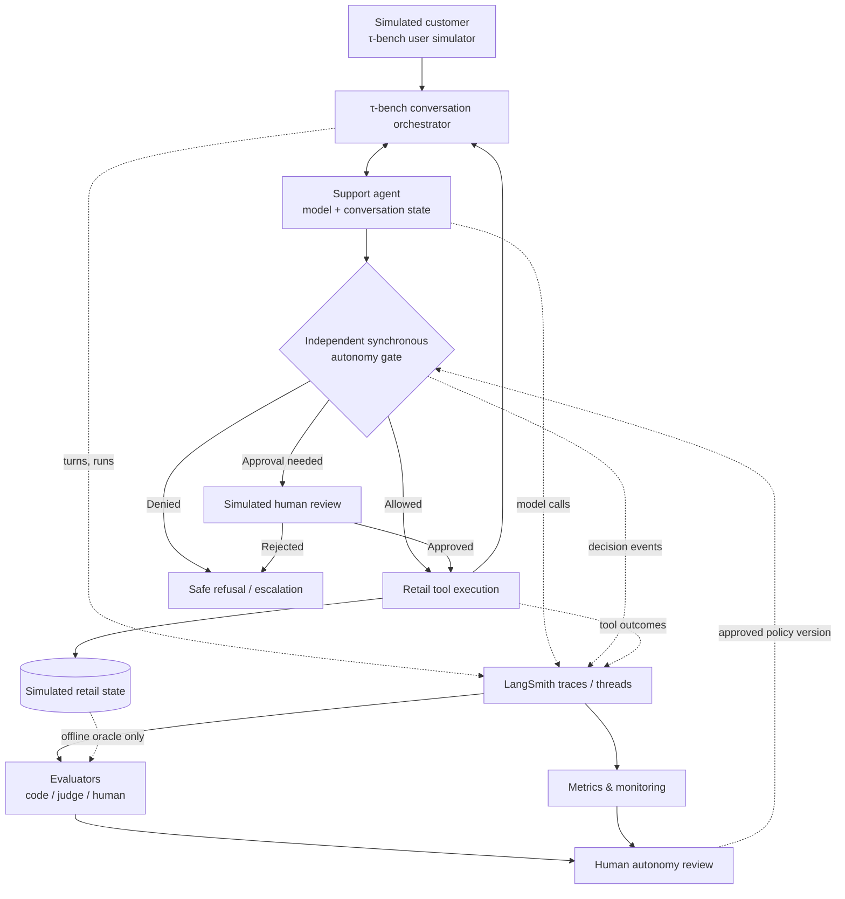
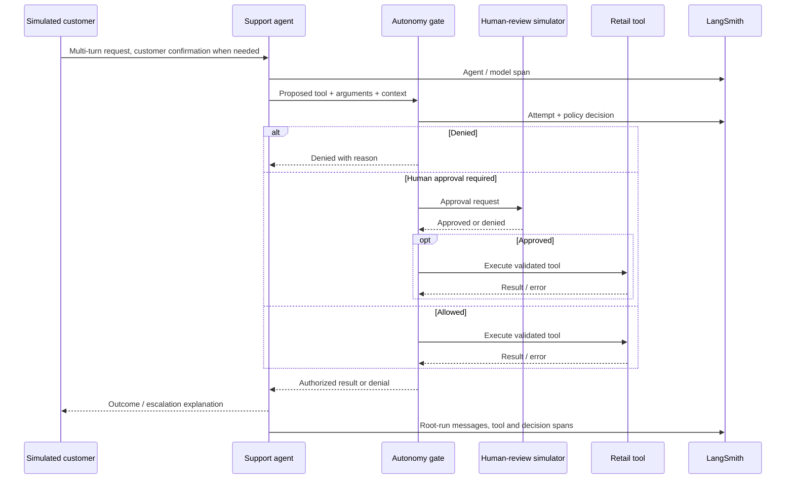

# Architecture and Telemetry Contract

[Home](../README.md) · [Master plan](../DEVELOPMENT.MD) · [Autonomy](AUTONOMY.md) · [Evaluation](EVALUATION.md)

**Status:** Target architecture, not implemented. Dependencies and APIs will be pinned/validated after the first upstream τ-bench checkout.

## Architectural intent

Use a small, understandable Python project that **adapts τ-bench** rather than copying an entire external application. Keep the upstream benchmark intact for baseline scoring. Apply observability and autonomy controls in our own clearly labeled experimental path.



**Most important trust boundary:** The model can **request** an action but cannot **authorize** its execution. The gate performs an independent validation before invoking a mutating tool.

## Deployment and repository boundaries

```text
workspace/
├── agent-autonomy-lab/       # our single GitHub repo
│   ├── docs/
│   ├── src/                  # added when implementation begins
│   ├── tests/
│   ├── datasets/
│   └── reports/
└── tau2-bench/               # separate upstream clone, pinned commit
```

Clone τ-bench **beside** this repository, never inside it: a nested Git repository would blur version boundaries and risk committing upstream code. A fork or submodule is **not** the starting point. Reassess only after finding a specific limitation. The initial baseline runs directly in upstream. Adapter tests later run from our repository. Configurations must record the upstream version.

## Component responsibilities

| Component | Responsibilities | Must not do |
| --- | --- | --- |
| τ-bench environment/user simulator | Provide tasks, synthetic customer, retail tools/state, original scoring | Be silently altered during baseline reporting |
| Agent adapter | Connect dialogue and tool requests to the benchmark orchestrator; expose trace hooks | Possess authority to bypass execution controls |
| Autonomy gate | Validate permissions and mandatory policy preconditions; enforce approve/deny | Infer permission merely from model confidence or an LLM judge score |
| Human-review simulator | Approve/deny designated operational actions deterministically or through explicit review | Substitute for customer confirmation |
| LangSmith adapter | Record correlated runs/threads, child calls and failures | Serve as an authorization mechanism |
| Evaluators | Score final state, events, quality, escalation; maintain evidence trail | Treat unavailable ground truth as negative/positive proof |
| Dashboard and incident workflow | Aggregate quality and operational signals, route investigations | Permit dangerous actions while waiting for async evaluation |

## End-to-end request sequence



## Proposed event and identifier contract

Store these fields in a versioned event schema once we inspect actual τ-bench structures:

| Field | Purpose | Example (illustrative) |
| --- | --- | --- |
| `simulation_id` | Correlate one full simulated run | `sim-00023` |
| `thread_id` | Group multi-turn traces | `thread-00023` |
| `scenario_id` / `task_id` | Task category and benchmark ground truth index | `retail:<verified-id>` |
| `turn_index` | Ordered conversation turn | `6` |
| `run_id` / `parent_run_id` | Link child LLM/tool spans | UUID |
| `agent_version`, `prompt_version` | Compare releases | `v1.1`, `prompt-003` |
| `model_id`, `user_model_id` | Agent and user-simulator model provenance | provider-qualified ID |
| `tool_schema_version`, `policy_version` | Reproduce permissions and API surface | `gate-001` |
| `autonomy_level` | Active authority at **decision time** | `1` |
| `traffic_type`, `scenario_category` | Separate synthetic vs. other; segment evaluations | `synthetic`, `cancellation` |
| `tool_name`, `argument_hash` | Audit attempted action without dumping secrets | `cancel_order`, safe hash |
| `decision`, `decision_reason` | Explain gate result | `DENIED`, `missing_customer_confirmation` |
| `outcome`, `elapsed_ms`, `tokens`, `cost` | Outcome + operations | `EXECUTION_FAILED`, numeric values |

Record explicit event state transitions using the gate event classes in [AUTONOMY.md](AUTONOMY.md#distinguish-events-and-metrics) (`ATTEMPTED`, `DENIED`, `PENDING_APPROVAL`, `APPROVED`, `EXECUTED`, `EXECUTION_FAILED`) so they cannot collapse into a single flag. Example policy decision:

```json
{
  "event_type": "gate_decision",
  "simulation_id": "sim-00023",
  "thread_id": "thread-00023",
  "tool_name": "cancel_order",
  "decision": "DENIED",
  "decision_reason": "missing_customer_confirmation",
  "autonomy_level": 2,
  "policy_version": "gate-001",
  "traffic_type": "synthetic"
}
```

**This is a proposed normalized event format, not a representation of current τ-bench output.** Schema mapping will be finalized after Milestone 2 inspection.

## LangSmith thread contract

[Current multi-turn evaluator documentation](https://docs.langchain.com/langsmith/online-evaluations-multi-turn) specifies that thread-level evaluators require supported **top-level `messages` inputs and outputs** and correlated threads. Model and tool calls can be traced as child runs, but child spans alone are not necessarily present in the assembled `all_messages` view. If the account supports it, a **trajectory** view can provide ordered tool-call evidence; availability varies by region/deployment.

Acceptance test: one task is navigable as a complete conversation; its child spans include tool invocations; a thread-level evaluator can consume the assembled messages without schema errors.

Multi-turn online evaluation can be delayed after conversation inactivity. **The tool gate executes synchronously regardless of the evaluator's timing.**

## Data handling

- Synthetic customer records only; no real PII or actual transaction APIs.
- Never commit `.env`, API keys, client secrets, provider payloads that might contain sensitive information, or raw traces without review.
- Keep simulator oracle goals/final-state expectation separate from messages available to the agent.
- Store experiment run manifests and sanitized examples in the repository; link to larger artifacts in LangSmith when access permits.
- Add consistent metadata to separate `official_upstream_baseline` from `custom_lab_experiment`.

## Design and integration risks

- **Benchmark drift:** Pin upstream code/tasks. Recent τ-bench releases changed grading in some domains; comparisons require matching versions.
- **Tool interception:** Confirm the true retail tool execution boundary before building the gate. An agent-only wrapper may not cover all paths.
- **Trace shape:** Root-level messages and child-run spans require correct nesting and correlation.
- **Latency/cost:** Instrumentation and judges incur overhead; show measured values by agent version.
- **Platform availability:** Some LangSmith widgets/trajectory features vary by deployment. Demonstrate core trace and scoring functionality before depending on an optional feature.

## Referenced upstream extension points

- [τ-bench repository and setup](https://github.com/sierra-research/tau2-bench)
- [Runnable custom agent examples](https://github.com/sierra-research/tau2-bench/blob/main/examples/agents/README.md), including `HalfDuplexAgent` and orchestrator examples.
- [τ-bench task evaluation contract](https://github.com/sierra-research/tau2-bench/blob/main/docs/evaluation.md)
- [LangSmith multi-turn evaluators](https://docs.langchain.com/langsmith/online-evaluations-multi-turn)
