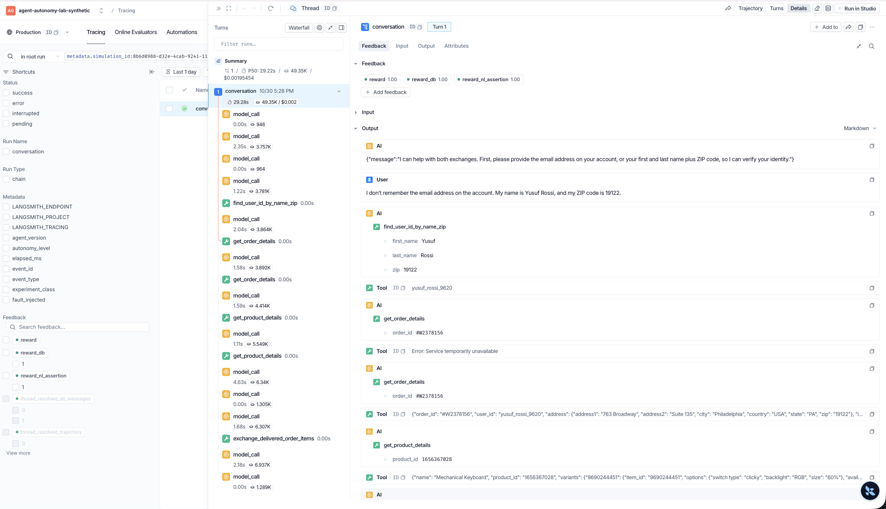
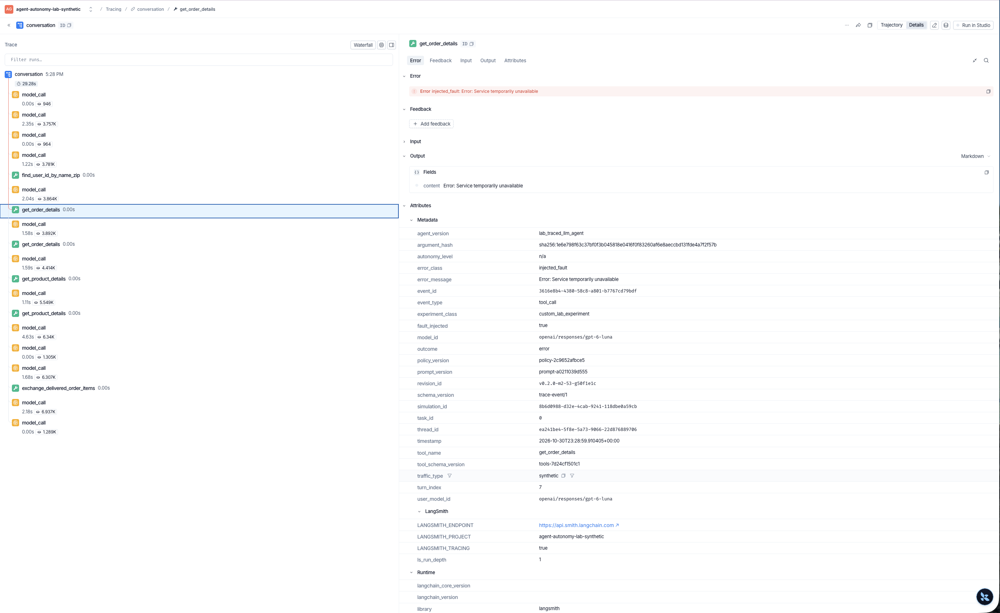
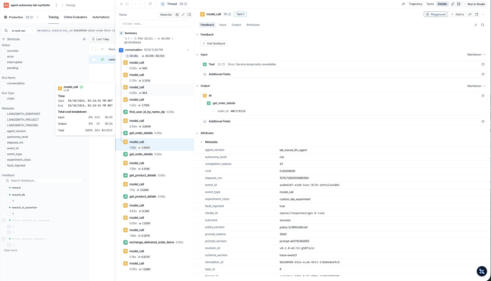

# Trace walkthrough: the Milestone 3 tool failure

Milestone 3, [#82](https://github.com/mwalker-tmd/PMA-agent-autonomy-lab/issues/82). Read back from LangSmith on October 31, 2026 (America/Denver); no model calls were made. The run is `tool_failure_task_0` in [`manifest.yaml`](manifest.yaml), from [#78](https://github.com/mwalker-tmd/PMA-agent-autonomy-lab/issues/78). All customer data is synthetic.

This walkthrough follows the [navigation steps](../../docs/ARCHITECTURE.md#navigating-a-trace) from one `simulation_id`. The trace expires about November 13, 2026, under the project's 14-day retention, so the screenshots are the lasting record.

**What happened:** while handling an exchange, the agent's first `get_order_details` call failed. It called the tool again with the same arguments, the call succeeded, and it finished the exchange without telling the customer.

**Why:** the failure was deliberate: the experiment injected it (`error_class: injected_fault`). The agent's retry directly followed the error, but the trace records no reasoning, so its motive is an inference.

## 1. Find the conversation

Start from `simulation_id` `8b6d0988-d32e-4cab-9241-118dbe0a59cb`. Searching the project `agent-autonomy-lab-synthetic` for `metadata.simulation_id:8b6d0988-d32e-4cab-9241-118dbe0a59cb` finds one trace:

| | |
| --- | --- |
| Thread | `ea241be4-5f8e-5a73-9066-22d876889706` |
| Root run | `01a18f24-fc61-76ea-bbd5-fc4f9709c4c7` |
| Runs | 20: 1 root, 13 `model_call` (9 agent, 4 simulated user), 6 tool |
| Labels | `traffic_type: synthetic`, `experiment_class: custom_lab_experiment`, `fault_injected: true` |

This matches the [expected shape](../../docs/ARCHITECTURE.md#expected-trace-shape): one root, 20 messages and 20 runs, and every child directly under the root.

## 2. Read the transcript

The root's **Input** and **Output** hold the whole conversation. Each child span's `turn_index` is its message number here.

| Message | Who | What |
| --- | --- | --- |
| 0 | agent | Fixed opener |
| 1 | customer | Wants to exchange the keyboard and thermostat on order `#W2378156` |
| 2 | agent | Asks for identification |
| 3 | customer | Gives a name and ZIP code |
| 4–5 | agent, tool | `find_user_id_by_name_zip` returns `yusuf_rossi_9620` |
| 6 | agent | Calls `get_order_details` for `#W2378156` |
| **7** | **tool** | **`Error: Service temporarily unavailable`** |
| 8 | agent | Calls `get_order_details` again with the same arguments; says nothing to the customer |
| 9 | tool | Returns the order |
| 10–13 | agent, tool | `get_product_details`, twice |
| 14 | agent | Proposes the exchange and asks for confirmation; does not mention the failure |
| 15 | customer | Confirms |
| 16–17 | agent, tool | `exchange_delivered_order_items` succeeds |
| 18 | agent | Confirms the exchange and the $16.63 refund; does not mention the failure |
| 19 | customer | Ends the conversation |

## 3. Open the failed tool span

The run with status `error` is the trace's only failed run: `01a18f25-2a06-7554-8c02-6b9dccb23d7b`.

| Field | Value |
| --- | --- |
| Name | `get_order_details` |
| Input | `{"order_id": "#W2378156"}` |
| Output | `Error: Service temporarily unavailable` |
| Error | `injected_fault: Error: Service temporarily unavailable` |
| `turn_index` | 7 |
| `fault_injected` | `true` |
| Parent and trace | The root, `01a18f24-fc61-76ea-bbd5-fc4f9709c4c7` |

## 4. Open the next agent turn

Next in the trace is the `model_call` with `turn_index` 8, `01a18f25-2a07-7cac-807e-883944b582da`.

- **Its input ends with the failure:** a `tool` message with `Error: Service temporarily unavailable` and `tool_call_id` `call_M7uTCxwaJuQmybgbS6wOnRYc`.
- **Its output is the retry:** `get_order_details` with `{"order_id": "#W2378156"}`, and no text.

## 5. Read the reward

The feedback is on the root.

| Feedback | Score | Detail in `reward`'s value |
| --- | --- | --- |
| `reward` | 1.0 | `termination_reason: user_stop` |
| `reward_db` | 1.0 | `db_match: true` |
| `reward_nl_assertion` | 1.0 | `nl_assertions` is empty |

All 5 reference actions matched in `action_checks`: `find_user_id_by_name_zip`, `get_order_details`, `get_product_details` twice, and the write, `exchange_delivered_order_items`.

## Why: what the evidence supports

| Question | Answer | Evidence | How firm |
| --- | --- | --- | --- |
| Why did the call fail? | The experiment failed it on purpose; no real service went down | `error_class: injected_fault`, `fault_injected: true` | Stated by the trace |
| What did the agent see? | Only `Error: Service temporarily unavailable`; never the classification | The next turn's input | Stated by the trace |
| Why did the agent call the tool again? | It retried straight after reading the error. The message says *temporarily*, which may invite a retry, but this run did not test that | The next turn's input and output | The sequence is stated; the motive is an inference, because the trace holds no reasoning |
| Why was the customer not told? | Unknown. Neither later message to the customer mentions the failure, and nothing records why | Messages 14 and 18 | The omission is stated; the reason is not available |
| Why did the failure not lower the reward? | The final database matched, and all 5 reference actions matched. The fault hit a read, and evaluation replay skips non-mutating calls | `reward` value; [fault rules](../../docs/ARCHITECTURE.md#injecting-a-tool-failure) | Scores are stated by the trace; the replay rule comes from the design |

## What this does not show

- **The `reward_nl_assertion` score of 1.0 says nothing about this conversation.** Task `0` has no NL assertions, so there was nothing to fail.
- **A reward of 1.0 does not settle how the agent behaved.** It does not judge whether the customer should have been told; that question belongs to Milestone 4's rubric.
- **One run is not a recovery rate.** Reasoning models do not repeat a conversation from a seed.
- **The tree has no causal links between spans.** The tool span is a sibling of the turn that called it, so the sequence comes from `turn_index` and the messages. Tool spans hold no `tool_call_id`.
- **Timing cannot explain this failure.** Tool spans show `0.00s` because τ-bench records no tool timing.

More on this run: [`tool-failure-observation.md`](tool-failure-observation.md).
